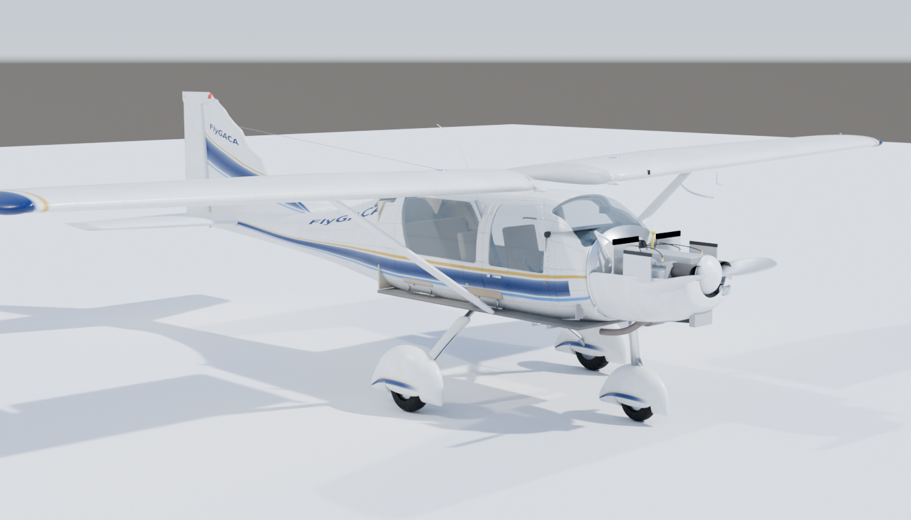
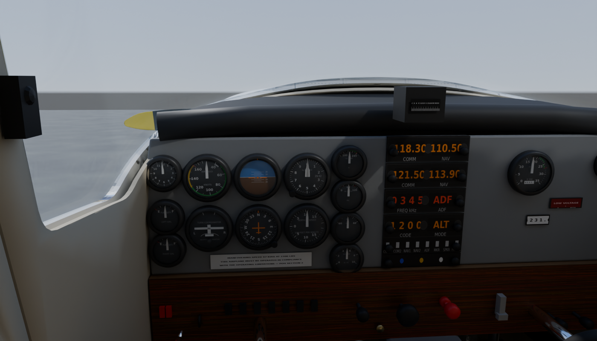
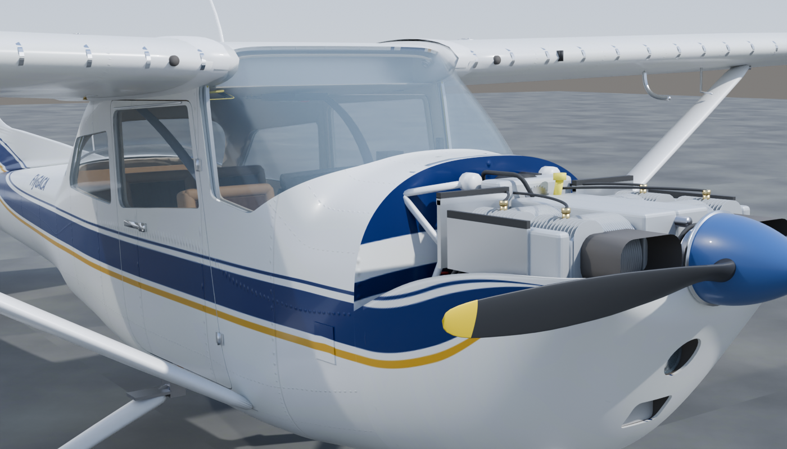

# Phase 8 — Realistic digital twin (Blender-built airframe, cockpit and engine)

**Open:** from the repository root run `python3 -m http.server 8000`, then visit
<http://localhost:8000/08_realistic_digital_twin/>. Everything is served from this folder
(three.js vendored), so it works offline. Arabic is the default; the top-right button switches
to English. `?q=high|medium|low` forces a quality level; `?lang=en` forces the language.

[النسخة العربية](README_AR.md) · [Audit & asset-gap report](docs/01_audit_and_asset_gap_report.md) ·
[Architecture & milestones](docs/02_modeling_architecture.md) · [Validation report](docs/03_validation_report.md)

## What this phase is

Phases 01–07 are box-and-cylinder prototypes. Phase 8 replaces the *visual* layer with a model
built in **Blender 4.5 LTS by scripts** (subdivision-surface airframe, lofted NACA wings, boolean
window and door openings, finned engine castings, textured instruments) and keeps the *logic*
layer from Phase 7 (POH-referenced systems simulation, scenarios, instrument scales).





| | Phase 7 | Phase 8 |
|---|---|---|
| Source | numpy script → GLB | Blender Python package → editable `.blend` + 3 GLB quality levels |
| Airframe | superellipse primitives | subdivided fuselage with real window/door cut-outs, doors on hinges, NACA 2412/0012 lofted wings, flaps/ailerons/elevator/rudder/trim tab on hinge frames, tubular gear with fairings, cowl with inlets |
| Surfaces | flat colours | PBR texture sets (albedo / ORM / normal): livery, rivet rows and panel seams, wear, glass, rubber, aluminium, wood-grain panel |
| Cockpit | 3D dial ticks | 15 instruments with faces drawn from `instruments.json`, radio stack, switches, push-pull controls, yokes, pedals, trim wheel, fuel selector, seats, belts |
| Engine | schematic | finned barrels and heads, rocker covers, pushrod tubes, plugs and leads, dual magneto, starter, alternator and belt, carburettor/airbox/filter, exhaust and muffler, mount, baffles; crank/cam/pistons/rods/valves animated |
| Lighting | room environment | generated sky HDR, shadow-mapped sun, GTAO (high) |
| Delivery | one GLB | high 310 k / medium 171 k / low 86 k triangles, Draco, 2048/1024/512 px textures, auto-selected by device |

## Using the viewer

- **Modes** (top bar): Exterior · Cockpit (camera at the pilot's eye, look around with the mouse/finger) ·
  Engine (upper cowl removed) · Systems (X-ray with the scenario drawer).
- **Left drawer**: cockpit controls wired to the Phase 7 simulation (master, avionics, ignition
  with START hold, throttle, mixture, carb heat, primer, fuel selector, flaps, lights, Kollsman),
  flight-control inputs (ailerons, elevator, rudder, trim), instructor flight state, faults, scenarios.
- **Right drawer**: explode slider and assembly animation, X-ray, labels, cowl, doors, wheel
  fairings, AO, displayed motion speed, hand-crank angle, camera presets, parts tree
  (show/hide/isolate per system or part), selected-part information, 2D gauges, sources.
- **Click/tap any part** for its bilingual name, a description tied to the POH, and a status badge:
  green = POH (page cited), gold = type data, grey = estimated.

## Rebuilding the model

```bash
08_realistic_digital_twin/scripts/get_blender.sh              # downloads Blender 4.5.15 LTS (Linux x64)
npm run textures8                                             # procedural textures + sky HDR (numpy, Pillow)
npm run build:model8                                          # .blend + high/medium/low GLBs + model indexes
npm run validate:glb8 && npm run test:py8 && npm test         # structure, Python tests, node tests
npm run test:e2e8                                             # Playwright browser test (needs Chromium)
npm run render8                                               # Cycles reference renders into docs/renders
```

The build is deterministic: CI rebuilds the model with the same Blender and compares parts,
triangle counts and sizes with the committed files (`scripts/compare_builds.py`).

## Files

```
blender/build.py            entry point (run inside Blender)
blender/c172/units.py       every dimension with its status (poh / type_data / estimated) and reference
blender/c172/profiles.py    NACA airfoils, superellipses, resampling (pure Python, unit tested)
blender/c172/shapes.py      bmesh lofts, revolves, tubes, modifiers, frames, parenting
blender/c172/textures.py    albedo / ORM / normal sets, livery, rivets, sky HDR
blender/c172/dials.py       instrument faces and placards from data/instruments.json
blender/c172/airframe.py    fuselage, glazing, doors, wings, control surfaces, empennage, struts, details
blender/c172/gear.py        main and nose gear, wheels, brakes, fairings
blender/c172/powerplant.py  cowl halves, nose bowl, inlets, landing light, spinner, propeller, exhaust
blender/c172/cockpit.py     panel, instruments, radio stack, controls, yokes, pedals, seats, belts
blender/c172/engine.py      O-320 assembly, internals, accessories, mount, baffles
blender/c172/export.py      LOD settings, Draco export, model index
blender/render_preview.py   Cycles reference renders
models/                     C172N_realistic.blend, *_high/medium/low.glb, model_index_*.json
assets/textures, assets/hdri generated textures (2048 + 1024/512 copies) and sky.hdr
js/                         viewer.js (renderer), rig.js (parts + animation), app.js (UI), Phase 7 sim/scenarios/gauges/i18n
data/                       instruments.json, parts_catalog.json (69 bilingual entries), poh_references.json
tests/, scripts/            Python tests, node tests, Playwright test, GLB validator, build comparison
docs/                       audit, architecture, validation report, renders
```

## Limits (read before using this for instruction)

- Geometry is **representative**, built from POH overall dimensions and photographs — not from
  Cessna drawings, the IPC or Lycoming engineering data. Fuselage sections, window outlines, cowl
  shape, panel layout, engine accessory placement, strut and gear details are estimates.
- Installed equipment (avionics, wheel fairings, placards) varies by serial number.
- The simulation is Phase 7's teaching model, calibrated only to the POH figures listed in
  `data/poh_references.json`.
- Nothing here is approved for flight, maintenance or training credit. Use the aircraft's POH/AFM
  and your instructor.

## Next steps

1. Replace estimated sections with measurements of the FlyGACA aircraft (photogrammetry or tape).
2. Equipment list of the actual aircraft → panel and avionics.
3. Flight-dynamics layer (POH Section 5 performance) so the control surfaces fly the aircraft.
4. Instructor/student progress tracking and integration on FlyGACA.com.
