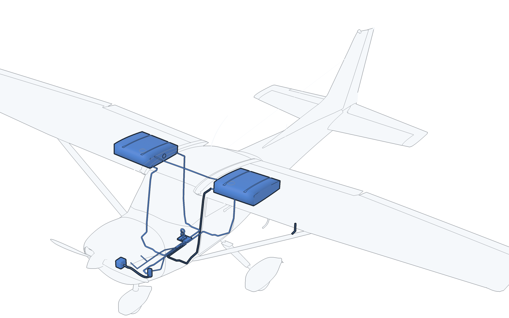
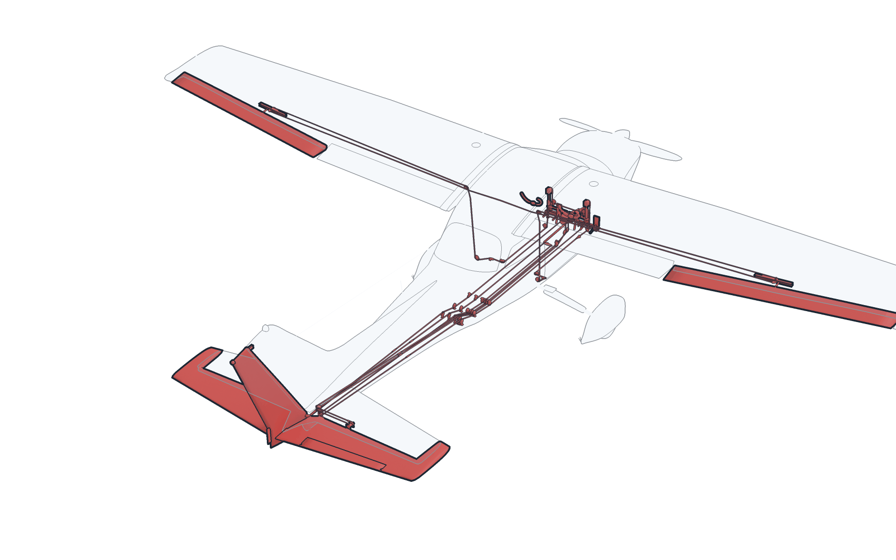
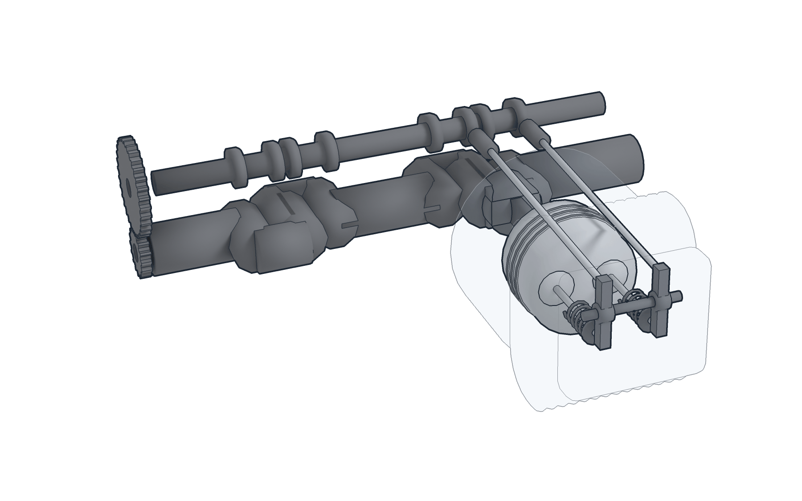
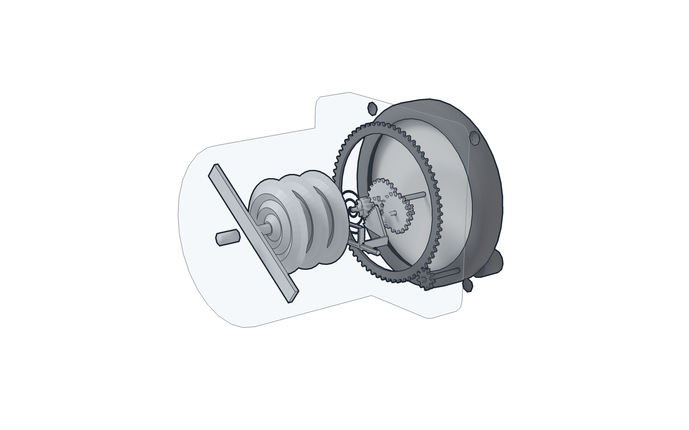

# Phase 8 — Realistic digital twin (Blender-built airframe, cockpit and engine)

**Open:** from the repository root run `python3 -m http.server 8000`, then visit
<http://localhost:8000/08_realistic_digital_twin/>. Everything is served from this folder
(three.js vendored), so it works offline. Arabic is the default; the top-right button switches
to English. `?q=high|medium|low` forces a quality level; `?lang=en` forces the language.

[النسخة العربية](README_AR.md) · [Audit & asset-gap report](docs/01_audit_and_asset_gap_report.md) ·
[Architecture & milestones](docs/02_modeling_architecture.md) · [Validation report](docs/03_validation_report.md) ·
[Aircraft measurement workflow](docs/04_aircraft_measurements.md) ·
[Shape reference](docs/05_shape_reference.md) · [Parts index](docs/06_parts_index.md) ·
[Under the skin](docs/07_under_the_skin.md) · [Paint, markings and the look](docs/11_paint_and_look.md)

## What this phase is

Phases 01–07 are box-and-cylinder prototypes. Phase 8 replaces the *visual* layer with a model
built in **Blender 4.5 LTS by scripts** (subdivision-surface airframe, lofted NACA wings, boolean
window and door openings, finned engine castings, textured instruments) and keeps the *logic*
layer from Phase 7 (POH-referenced systems simulation, scenarios, instrument scales).


| | Phase 7 | Phase 8 |
|---|---|---|
| Source | numpy script → GLB | Blender Python package → editable `.blend` + 3 GLB quality levels |
| Airframe | superellipse primitives | subdivided fuselage with real window/door cut-outs, doors on hinges, NACA 2412/0012 lofted wings, flaps/ailerons/elevator/rudder/trim tab on hinge frames, tubular gear with fairings, cowl with inlets |
| Surfaces | flat colours | PBR texture sets (albedo / ORM / normal): a paint scheme laid on each skin from where its texels lie in space, so the stripes cross every joint unbroken; markings as separate sharp pieces; fine rivet rows and panel seams, wear, glass, rubber, aluminium; in the cabin vinyl, pleated cloth, carpet, a two-tone liner, a lettered panel |
| Cockpit | 3D dial ticks | 15 instruments with faces drawn from `instruments.json`, radio stack, switches, push-pull controls, yokes, pedals, trim wheel, fuel selector, seats, belts |
| Engine | schematic | finned barrels and heads, rocker covers, pushrod tubes, plugs and leads, dual magneto, starter, alternator and belt, carburettor/airbox/filter, exhaust and muffler, mount, baffles; crank/cam/pistons/rods/valves animated |
| Lighting | room environment | a sky drawn by a shader that also lights the model, a concrete apron, sun with soft shadows, clear coat on the paint, shade baked into the cabin and the outside, bloom and grading (high, medium), GTAO and clear glass (high) |
| Delivery | one GLB | high 540 k / medium 225 k / low 137 k triangles, Draco, 2048 px textures (high) and 1024 px (medium, low), the paint of the fuselage twice as fine; auto-selected by device |
| Under the skin | nothing | structure, control runs, fuel, brake, air-pressure and electrical systems, the insides of the engine and of the flight instruments as separate named parts (high model), fasteners and a hardware kit (`.blend`): 1,193 parts in all |

## Using the viewer

- **Modes** (top bar): Exterior · **Cockpit** (the pilot's seat: the head turns and the body leans within
  limits, and the hand works the controls it can reach, on the model itself; see
  [docs/09_pilots_seat.md](docs/09_pilots_seat.md)) ·
  Engine (upper cowl removed) · Systems (X-ray with the scenario drawer) · **Flight** (the flight model
  flies the aircraft: runway, cruise or approach; keys or the on-screen wheel; outside or pilot's-eye camera;
  see [docs/08_flight_model.md](docs/08_flight_model.md)). The flight model has no certified fidelity.
- **Survey of the aircraft** ([docs/10_flight_survey.md](docs/10_flight_survey.md)): what to measure on the
  ground, in the seat and in flight, the sheet to fill in, and the tool that checks it and sets it beside the
  model. Nothing in the flight model or the seat is measured until a survey is recorded; the file is empty.
- **Flight lessons** (in the scenario list): stall and recovery, go-around, engine failure after takeoff.
  Their steps are checked live against the handbook's procedures; each records how it was flown and can be
  demonstrated by the scripted pilot. The engine failure is a fault of the fault panel.
- **Left drawer**: cockpit controls wired to the Phase 7 simulation (master, avionics, ignition
  with START hold, throttle, mixture, carb heat, primer, fuel selector, flaps, lights, Kollsman),
  flight-control inputs (ailerons, elevator, rudder, trim), instructor flight state, faults, scenarios.
- **Right drawer**: explode slider and assembly animation, X-ray, labels, cowl, doors, wheel
  fairings, AO, displayed motion speed, hand-crank angle, camera presets, parts tree
  (show/hide/isolate per system or part), selected-part information, 2D gauges, sources.
- **Click/tap any part** for its bilingual name, a description tied to the POH, and a status badge:
  green = measured aircraft, blue = POH (page cited), gold = type data, grey = estimated.

## Under the skin

The high model and the `.blend` go under the skin, so that any part can be shown on its own or in
place: spars, ribs, frames and stringers; every cable, pulley, bellcrank and push-pull rod of the
flight controls and the flap drive; the fuel tanks, pipes, selector valve and vent; brake, pitot,
static, vacuum and stall-warning plumbing; contactors, bus and wiring; inside the engine, the valve
train, timing gears, oil system and the inside of the carburetor; inside the flight instruments,
the capsules, linkages, gear trains, gyro rotors and gimbals; cabin heating and ventilation, and
the cabin lights; the seat rails, rollers and locks, the door latches and the openable window,
the baggage net; the radio units behind the panel with their antenna cables; and, in the `.blend`,
rivet rows, screws, bolts, a kit of standard hardware and what is fitted only on the ground
(control lock, gust lock, pitot cover, tie-downs, tow bar).






- [`docs/06_parts_index.md`](docs/06_parts_index.md): every part with its id, English and Arabic name, level and status.
- [`docs/07_under_the_skin.md`](docs/07_under_the_skin.md): what each pack was built from, what is representative, how the runs are laid out, how to add a pack.
- [`../09_book_figures/atlas/`](../09_book_figures/atlas/README.md): a picture of every assembly; `npm run part -- render --part <id>` draws any part.

The handbook shows what the aircraft is made of and how its systems are joined; it gives no
positions. Positions, sizes and routes under the skin are representative, and what is drawn inside
the engine and the instruments shows how a part of that kind works, not the maker's design.

## Rebuilding the model

```bash
08_realistic_digital_twin/scripts/get_blender.sh              # downloads Blender 4.5.15 LTS (Linux x64)
npm run build:model8                                          # position maps, textures, then .blend + high/medium/low GLBs + model indexes + parts_all.json
npm run posmaps8 && npm run textures8                         # (the first two steps alone: where each texel of the painted skins lies, then the textures; numpy, Pillow)
npm run parts:index                                           # docs/06_parts_index.md from models/parts_all.json
npm run validate:glb8 && npm run test:py8 && npm test         # structure, Python tests, node tests
npm run validate:geometry8                                    # published dimensions, attachments, mesh health, nothing through the skin
npm run test:e2e8                                             # Playwright browser test (needs Chromium)
npm run render8                                               # Cycles reference renders into docs/renders
```

The build is deterministic: CI rebuilds the model with the same Blender and compares parts,
triangle counts and sizes with the committed files (`scripts/compare_builds.py`).

## Files

```
blender/build.py            entry point (run inside Blender)
blender/c172/units.py       every dimension with its status (measured / poh / type_data / estimated) and reference
blender/c172/profiles.py    NACA airfoils, superellipses, resampling (pure Python, unit tested)
blender/c172/shapes.py      bmesh lofts, revolves, tubes, modifiers, frames, parenting
blender/posmaps.py, c172/posmap.py   where each texel of the painted skins lies on the aircraft (read off the built surfaces)
blender/c172/textures.py    albedo / ORM / normal sets, the paint scheme, rivets, cabin trim, sky HDR
blender/c172/sections.py    the section tables of the fuselage and the cowl (shared with the builders)
blender/c172/atlas.py, decals.py     markings and panel lettering: their atlases, and the pieces laid on the skin
blender/c172/ao.py          shade baked into the exported model (vertex colours)
blender/c172/dials.py       instrument faces and placards from data/instruments.json
blender/c172/airframe.py    fuselage, glazing, doors, wings, control surfaces, empennage, struts, details
blender/c172/gear.py        main and nose gear, wheels, brakes, fairings
blender/c172/powerplant.py  cowl halves, nose bowl, inlets, landing light, spinner, propeller, exhaust
blender/c172/cockpit.py     panel, instruments, radio stack, controls, yokes, pedals, seats, belts
blender/c172/engine.py      O-320 assembly, internals, accessories, mount, baffles
blender/c172/export.py      LOD settings, detail level per LOD, Draco export, model index, parts list
blender/c172/detail/        what lies under the skin: structure, controls, flap drive, fuel, pneumatic, brakes, electrical, fasteners
blender/c172/detail/common.py, geom2d.py, lanes.py   sheet-metal and mechanism builders; plane geometry; where the runs lie
blender/threeview.py        scaled outline drawings of the model, to lay over the handbook three-view
blender/render_preview.py   Cycles reference renders (`npm run render8`, `npm run gallery8`)
blender/validate_geometry.py published dimensions, attachments and skin containment of the built scene
models/                     C172N_realistic.blend, *_high/medium/low.glb, model_index_*.json, parts_all.json (every part, all levels)
assets/textures, assets/hdri generated textures (2048 + 1024 copies) and sky.hdr (the sky of the Cycles renders)
js/                         viewer.js (renderer, effects), sky.js (sky and apron), rig.js (parts + animation), app.js (UI), compatibility imports
js/flightmode.js            flight mode: the world, the cameras, the keys and the on-screen wheel
js/seat.js, cockpit_controls.js, cockpit.js   the pilot's seat: limits and reach, what each control does, the eye and the hand
../shared/js/                canonical Phase 7/8 simulation, scenarios and SVG gauges
data/                       instruments.json, parts_catalog.json (91 bilingual entries), poh_references.json
data/measurement_schema.json, aircraft_measurements.json, measurement_template.csv
data/flight_survey.json, flight_survey_template.csv   the survey for the flight model and the pilot's seat (no record yet); js/survey.js, scripts/flight_survey.mjs
tests/, scripts/            Python tests, node tests, Playwright test, GLB validator, build comparison
docs/                       audit, architecture, validation report, shape reference, parts index, under the skin, flight model, pilot's seat, survey, paint and look, renders
```

## Limits (read before using this for instruction)

- Geometry is **representative**. The outline of the airframe follows the manufacturer's three-view
  drawing and cabin figures in the handbook and reproduces every published dimension
  ([how and how well](docs/05_shape_reference.md)); cross-sections, the nose cap, panel layout,
  engine accessory placement and gear details are estimates, and nothing has been measured on the
  FlyGACA aircraft yet.
- What lies under the skin is built from what the POH shows and names, not from Cessna drawings,
  the maintenance manual or the IPC: the parts exist, their positions, sizes and routes are
  representative ([what is from where](docs/07_under_the_skin.md)). It explains; it is not a
  maintenance reference.
- Installed equipment (avionics, wheel fairings, placards) varies by serial number.
- The simulation is Phase 7's teaching model, calibrated only to the POH figures listed in
  `data/poh_references.json`.
- Nothing here is approved for flight, maintenance or training credit. Use the aircraft's POH/AFM
  and your instructor.

## Next steps

1. Check the outline against square-on photographs of the FlyGACA aircraft and replace estimated
   sections with measurements (the list of the most useful readings is in the shape reference).
2. Equipment list of the actual aircraft → panel and avionics.
3. Flight-dynamics layer (POH Section 5 performance) so the control surfaces fly the aircraft.
4. Instructor/student progress tracking and integration on FlyGACA.com.
