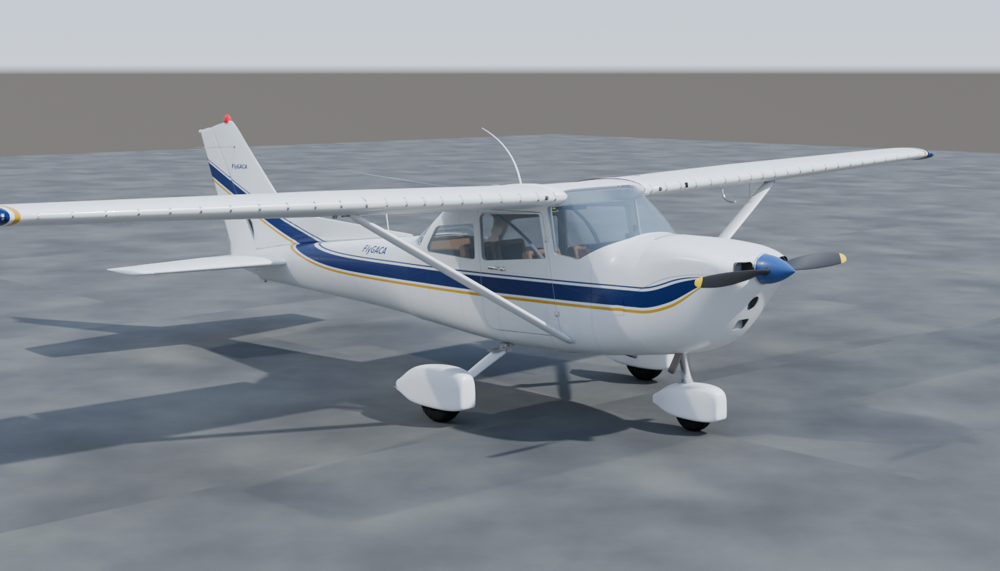
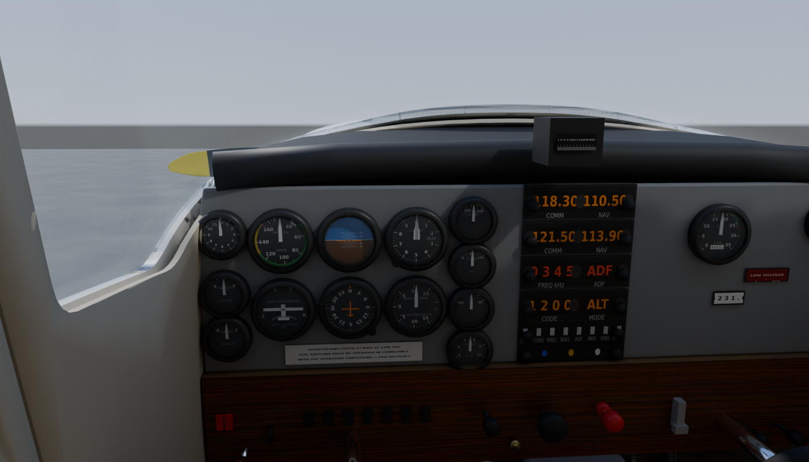
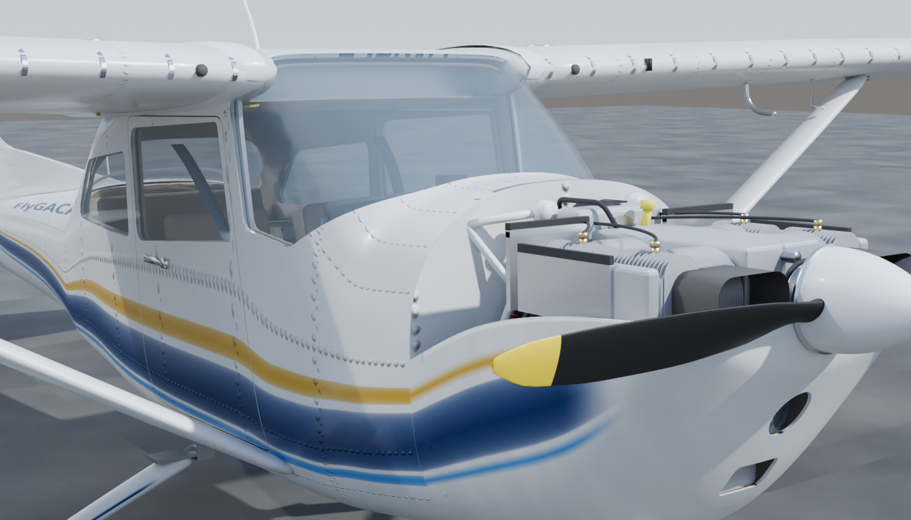
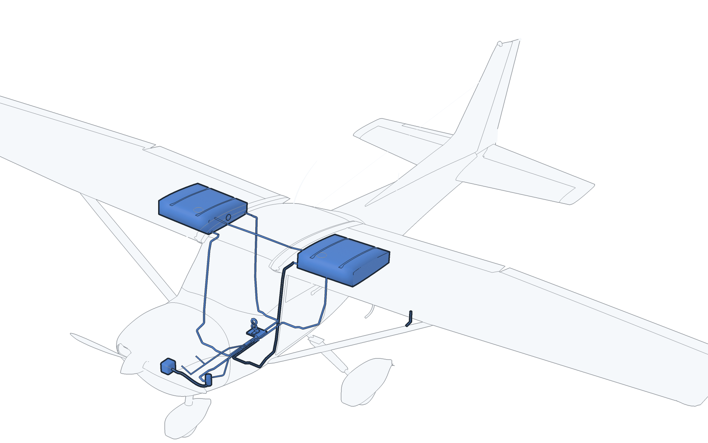
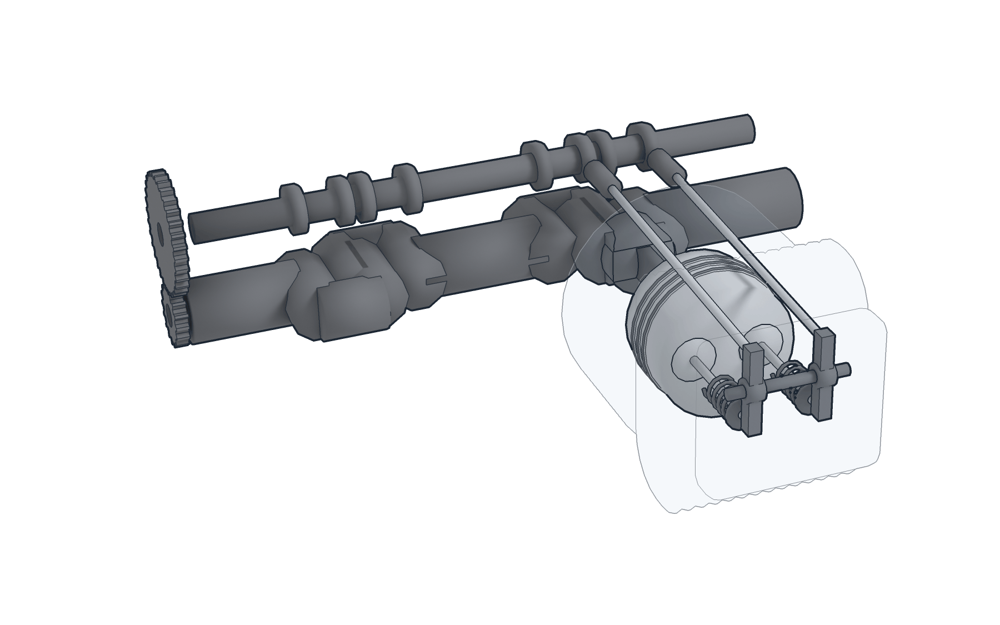
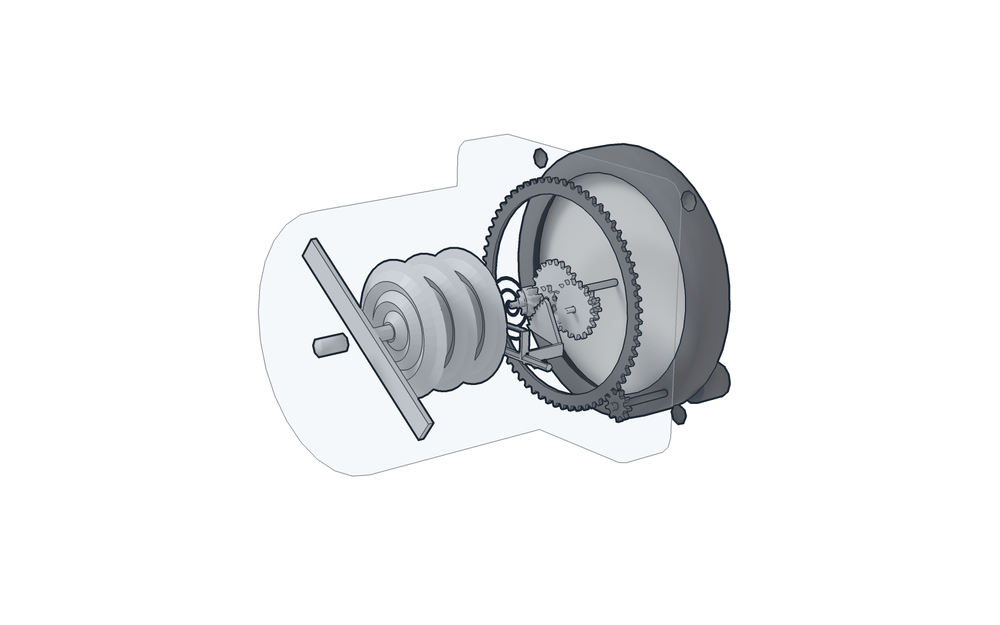

# المرحلة 8 — التوأم الرقمي الواقعي (هيكل ومقصورة ومحرك مبنية في Blender)

**التشغيل:** من جذر المستودع شغّل `python3 -m http.server 8000` ثم افتح
<http://localhost:8000/08_realistic_digital_twin/>. كل شيء يُخدم من هذا المجلد (مكتبة three.js مضمّنة) فيعمل دون اتصال بالإنترنت. اللغة الافتراضية العربية، والزر أعلى الصفحة يبدّل إلى الإنجليزية. يمكن فرض مستوى الجودة بـ `?q=high|medium|low` واللغة بـ `?lang=en`.

[English](README.md) · [تقرير التدقيق والفجوات](docs/01_audit_and_asset_gap_report.md) · [البنية والمراحل](docs/02_modeling_architecture.md) · [تقرير التحقق](docs/03_validation_report.md)

## ما هذه المرحلة

المراحل 01–07 نماذج أولية من صناديق وأسطوانات. المرحلة 8 تستبدل الطبقة **البصرية** بنموذج مبنيّ في **Blender 4.5 LTS عبر سكربتات** (هيكل بأسطح تقسيم فرعي، أجنحة مبنية من مقاطع NACA، فتحات نوافذ وأبواب حقيقية، مسبوكات محرك مزعنفة، عدادات بوجوه مرسومة) وتحتفظ بطبقة **المنطق** من المرحلة 7 (محاكاة الأنظمة الموثّقة بـ POH، السيناريوهات، تدريجات العدادات).





| | المرحلة 7 | المرحلة 8 |
|---|---|---|
| المصدر | سكربت numpy → GLB | حزمة Blender Python → ملف `.blend` قابل للتحرير + ثلاثة مستويات جودة GLB |
| الهيكل | أشكال أولية | جسم مقسّم فرعيًا بفتحات نوافذ وأبواب، أبواب على مفصلات، أجنحة NACA 2412/0012، قلابات وجنيحات ورافع ودفة ولسان موازنة على محاور، عجلات أنبوبية بأغطية، غطاء محرك بفتحات |
| الأسطح | ألوان مسطّحة | خامات PBR (لون/ORM/عادي): طلاء وخطوط، براشيم ودرزات، تآكل، زجاج، مطاط، ألمنيوم، لوحة خشبية |
| المقصورة | علامات ثلاثية الأبعاد | 15 عدادًا بوجوه مرسومة من `instruments.json`، مجموعة راديو، مفاتيح، أذرع سحب ودفع، عجلتا قيادة، دواسات، عجلة موازنة، محدد وقود، مقاعد وأحزمة |
| المحرك | تخطيطي | أسطوانات ورؤوس مزعنفة، أغطية روافع، أنابيب قضبان الدفع، شمعات وأسلاك، مغناطيس مزدوج، بادئ حركة، مولد وسير، مكربن وصندوق هواء وفلتر، عادم وكاتم، حامل، حواجز؛ المرفق والكامات والمكابس والأذرع والصمامات متحركة |
| الإضاءة | بيئة غرفة | سماء HDR مولّدة، شمس بظلال، إطباق محيطي GTAO (العالي) |
| التسليم | GLB واحد | عالٍ 490 ألف / متوسط 192 ألف / منخفض 96 ألف مثلث، ضغط Draco، خامات 2048/1024/512، اختيار تلقائي حسب الجهاز |

## ما تحت الجلد

النموذج العالي الجودة وملف `.blend` مفصّلان إلى ما تحت الجلد، ليمكن عرض أي جزء لوحده أو في موضعه:
العوارض والأضلاع والإطارات والدعامات الطولية؛ كل كابل وبكرة وذراع مرفقي وقضيب دفع في أنظمة التحكم
وتحريك القلابات؛ خزانا الوقود والأنابيب وصمام الاختيار والتهوية؛ تمديدات الكوابح والبيتوت والضغط الساكن
والتفريغ وإنذار الانهيار؛ الملامسات وقضيب التوزيع والأسلاك؛ داخل المحرك (توابع الكامات وقضبان الدفع
والأذرع المتأرجحة ونوابض الصمامات وتروس التوقيت ونظام الزيت وداخل المكربن)؛ داخل عدادات الطيران
(الكبسولات والوصلات والتروس والجيروسكوبات وحلقاتها)؛ وفي ملف `.blend` صفوف البرشام والبراغي
والمسامير وطقم من العتاد القياسي. المجموع 1084 جزءًا.





- [فهرس الأجزاء](docs/06_parts_index.md): كل جزء برقمه واسمه بالعربية والإنجليزية ومستواه ومصدره.
- [ما تحت الجلد](docs/07_under_the_skin.md) (بالإنجليزية): ما بُني من دليل التشغيل وما هو تقريبي.
- [الأطلس](../09_book_figures/atlas/README.md): صورة لكل نظام؛ والأمر `npm run part -- render --part <id>` يرسم أي جزء.

دليل التشغيل يبيّن مكوّنات الطائرة وكيف تتصل أنظمتها، ولا يعطي مواضع. المواضع والمقاسات والمسارات تحت
الجلد تقريبية: تصلح للشرح وليست مرجعًا للصيانة.

## استخدام العارض

- **الأوضاع** (الشريط العلوي): الخارج · قمرة القيادة (الكاميرا عند عين الطيار) · المحرك (الغطاء العلوي مُزال) · الأنظمة (أشعة مع درج السيناريوهات).
- **الدرج الأيسر**: أدوات القيادة المربوطة بمحاكاة المرحلة 7، أسطح التحكم، حالة الطيران للمدرب، الأعطال، السيناريوهات.
- **الدرج الأيمن**: التفكيك وحركة التجميع، الأشعة، التسميات، الغطاء، الأبواب، أغطية العجلات، سرعة الحركة، زاوية المرفق، الكاميرات، شجرة الأجزاء (إظهار/إخفاء/عزل)، معلومات الجزء المحدد، العدادات ثنائية الأبعاد، المصادر.
- **انقر أي جزء** لعرض اسمه بالعربية والإنجليزية وشرحه المرتبط بـ POH وشارة التوثيق: أخضر = من POH (الصفحة مذكورة)، ذهبي = بيانات النوع، رمادي = تقديري.

## إعادة بناء النموذج

```bash
08_realistic_digital_twin/scripts/get_blender.sh   # تنزيل Blender 4.5.15 LTS
npm run textures8                                  # الخامات وسماء HDR
npm run build:model8                               # .blend + GLB بثلاثة مستويات + فهارس
npm run validate:glb8 && npm run test:py8 && npm test
npm run test:e2e8                                  # اختبار المتصفح (Playwright)
npm run render8                                    # صور مرجعية بمحرك Cycles
```

البناء حتمي: يعيد التكامل المستمر بناء النموذج بنفس إصدار Blender ويقارن الأجزاء وعدد المثلثات والأحجام مع الملفات المحفوظة.

## الحدود (اقرأها قبل الاستخدام التعليمي)

- الهندسة **تمثيلية** مبنية من الأبعاد المنشورة والصور، وليست من رسومات Cessna أو كتالوج القطع أو بيانات Lycoming الهندسية. الشكل الخارجي يتبع صورة جانبية لطائرة Cessna 172 ويطابق الأبعاد المنشورة (باع الجناح، الطول، قاعدة العجلات، المسافة بين العجلتين، باع الذيل، خلوص المروحة) — التفاصيل في [مرجع الشكل](docs/05_shape_reference.md). المقاطع العرضية ومقدمة الغطاء وتوزيع اللوحة ومواضع ملحقات المحرك تقديرية، ولم يُقَس شيء بعد على طائرة FlyGACA نفسها.
- التجهيزات المركّبة (الأجهزة الإلكترونية، أغطية العجلات، اللوحات) تختلف حسب الرقم التسلسلي.
- المحاكاة هي نموذج المرحلة 7 التعليمي، معايَر فقط على أرقام POH المذكورة في `data/poh_references.json`.
- لا شيء هنا معتمد للطيران أو الصيانة أو احتساب التدريب. ارجع إلى POH/AFM الخاص بالطائرة وإلى المدرب.

## الخطوات التالية

1. مطابقة الشكل مع صور جانبية وأمامية لطائرة FlyGACA نفسها واستبدال المقاطع التقديرية بقياسات فعلية.
2. قائمة تجهيزات الطائرة الفعلية → اللوحة والأجهزة.
3. طبقة ديناميكا طيران (أداء القسم 5 في POH) لتطير الطائرة بأسطح التحكم.
4. تتبع تقدم المتدرب والمدرب والدمج في FlyGACA.com.
