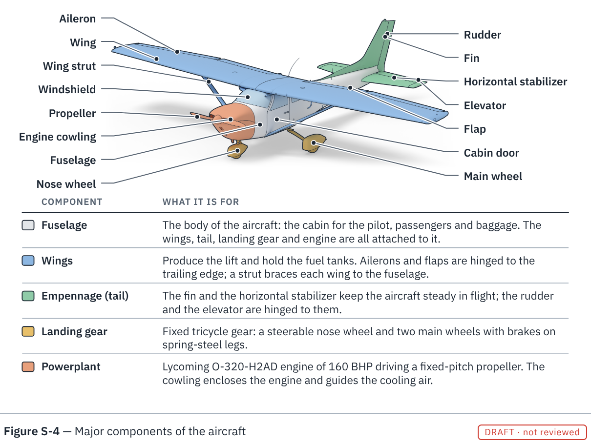
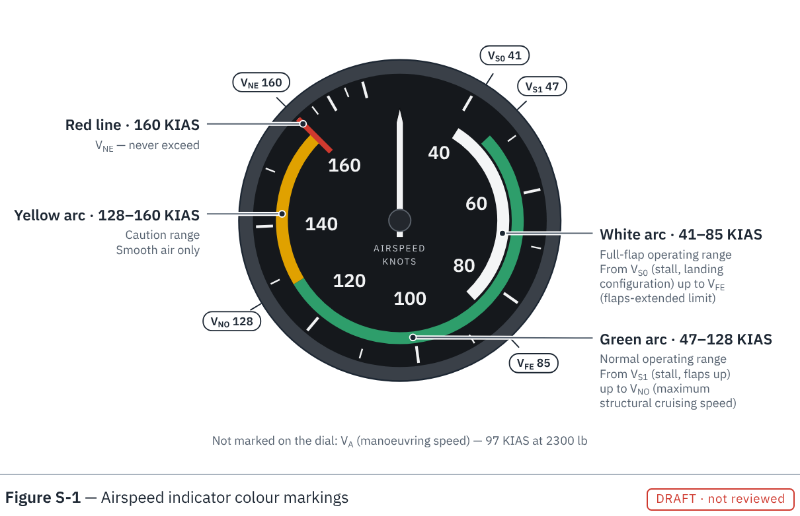
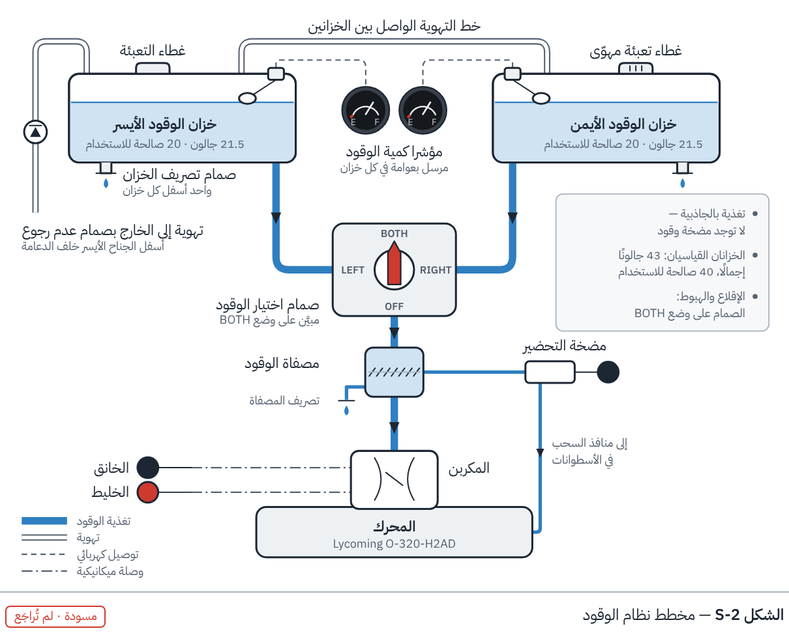
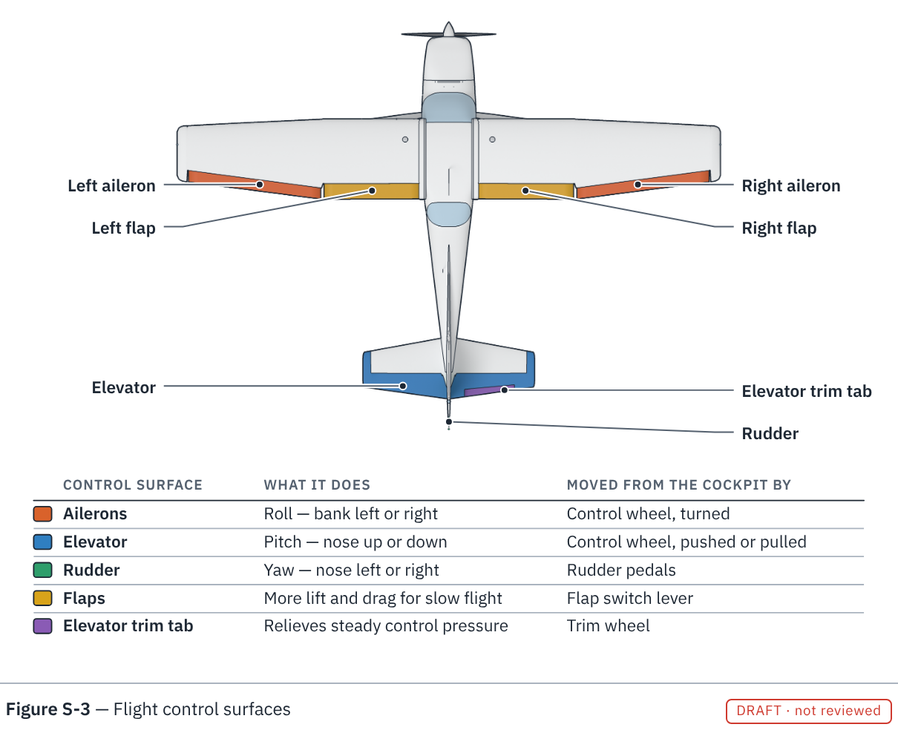
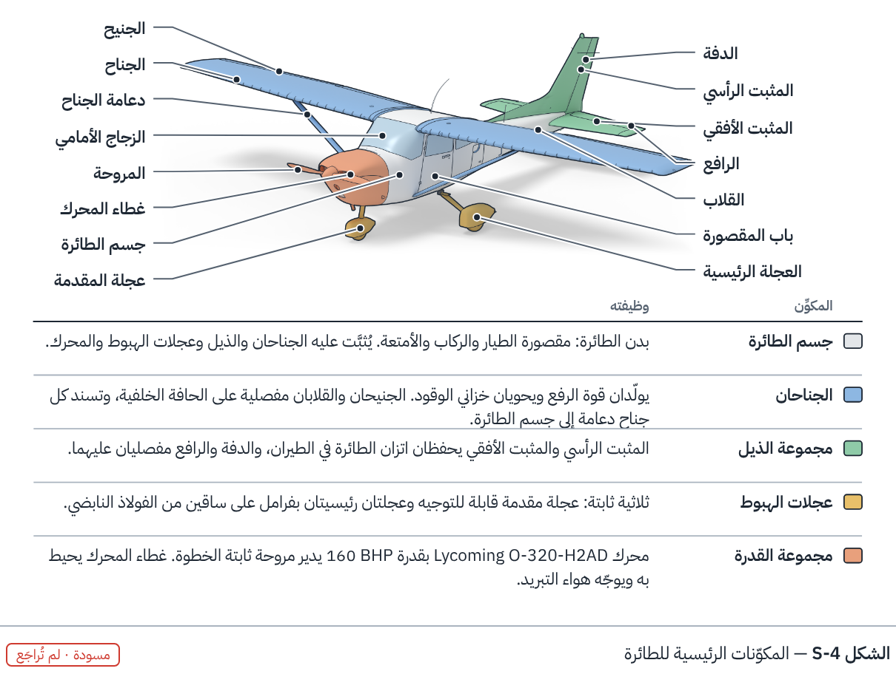
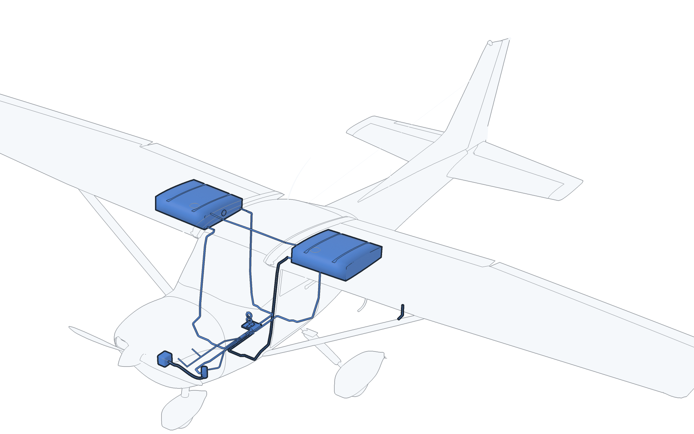

# Phase 9 — Book figures

Print-ready figures for the FlyGACA Cessna 172N book, built from the same data as the simulator and
the 3D twin, in English and Arabic.

**Start with [the plan](PLAN.md)** — which kind of picture to use for which job, why the generated
aircraft did not look right, what was done about it, and the order of work. [النسخة العربية](README_AR.md)



## Four samples of the methods that work today

| | |
|---|---|
|  | **S-1 · Instrument, drawn from data.** Scale, arcs and red line are read from `08_realistic_digital_twin/data/instruments.json`. |
|  | **S-2 · System schematic (Arabic edition shown).** Symbols and four line codes; capacities from the POH constants in `shared/js/sim.js`. |
|  | **S-3 · Illustration from the 3D twin, plan view.** Soft tones and ink outlines, not a fake photograph; labels placed by code from the model's part names. |
|  | **S-4 · Illustration from the 3D twin, three-quarter view (Arabic edition shown).** The five major components tinted; the engine named in the legend comes from the POH table. |

All four are `draft`: nobody has yet checked them against the aircraft's own POH.

## Build

```bash
npm ci                    # Playwright, once
npm run figures           # every figure, both languages -> 09_book_figures/out/
npm run figures:render    # re-render the 3D illustrations in Blender (only when the model or a camera changes)
npm run figures:check     # build everything into a temporary folder; fails if any text runs off a figure
npm test                  # includes tests/figures.test.mjs
npm run test:figures:py   # the line-drawing rules of the illustrations (numpy)
```

| Output | Use |
|---|---|
| `out/<lang>/<id>.pdf` | Print master: exact size in millimetres, vector, fonts embedded, no caption |
| `out/<lang>/<id>.svg` | Editable vector (vector figures only; install IBM Plex Sans Arabic to edit) |
| `out/preview/<id>.<lang>.png` | Review sheet with figure number, caption and review status |

With the pinned Playwright, rebuilding an unchanged figure gives byte-identical files, so git shows only real changes.

To work on one figure, serve the repository root (`npm run serve`) and open
`/09_book_figures/figure.html?fig=fuel-system&lang=ar&preview=1`.

## Add a figure

1. Add an entry to [`figures.json`](figures.json): `id`, `number`, `kind`, `method`, bilingual `title`,
   `sources` (POH page for every fact) and `status: "draft"`.
2. Put its text in `data/<name>.json` under `strings.en` and `strings.ar` (same keys in both).
3. Write `js/figures/<name>.js` exporting `size` (`[width, height]`, one unit = 0.1 mm) and
   `draw({ svg, t, text, data, json, lang, dir })`. Read numbers from the repository's data files
   rather than typing them.
4. For a figure from the 3D twin, add `data/<name>.render.json` (camera, tinted parts, parts to label)
   and reference it as `render` in the manifest. `render_figure.py` writes the picture and the pixel
   position of every labelled part; `js/callouts.js` places the labels. `--quick` gives a small
   preview in half a minute for choosing the camera; `--anchors-only` moves labels without rendering.
5. `npm run figures && npm test`.

## Plates for the handbook

The handbook (the book repository) takes figures that are numbered callouts over a picture, with no words in the artwork, as an SVG
of at most 40 KB or a JPEG colour plate of at most 800 KB. [`handbook/`](handbook/README.md) makes them from the twin: renders of the
aircraft, of its panel and of single instruments, encoded as the JPEG plates the book's build accepts, and a drawing of the airfoil as
an SVG, with the callout numbers of the list under the figure they replace. What to copy into the book is `handbook/out/book/`.

```bash
npm run plates:render && npm run plates:build && npm run test:plates:py
```

## Any part on its own

The model goes under the skin: structure, control runs, system components, the insides of the
engine and of the instruments, the cabin fittings and fasteners are separate, named parts, 1,174 in all. Their ids, with English and Arabic names, are in the
[parts index](../08_realistic_digital_twin/docs/06_parts_index.md); a picture of every assembly, with the
command that made it, is in the [atlas](atlas/README.md).



```bash
npm run part:list                                                  # every part: id, system, level, name
npm run part -- render --part ENGINE.piston_1                      # one part, drawn alone
npm run part -- render --part "WING_L.rib_*" --context             # in place: the rest of the aircraft as a phantom
npm run part -- render --part @fuel_system --context --frame aircraft --grow 0.006 --tint "#3B7DD8"
npm run part -- render --part @altimeter --ghost PANEL.ALT.case --azimuth 50      # a mechanism, with its case as a phantom
npm run part -- render --part HARDWARE.bolt                        # one piece of standard hardware, at its real size
npm run part -- export --part @aileron_control --out aileron.glb   # the same parts as a 3D file
python3 09_book_figures/atlas.py                                   # redraw the atlas
```

Pictures go to `09_book_figures/parts/` as transparent PNGs, each with a small JSON file naming the
parts in it.

| An id can be | Example |
|---|---|
| a part | `ENGINE.piston_1` |
| a group, with everything in it | `WING_L` |
| a pattern | `"WING_L.rib_*"`, `"CONTROLS.*pulley*"` |
| an assembly: every part of one system or mechanism, wherever it is | `@fuel_system`, `@aileron_control`, `@altimeter`, `@engine_internals` |
| a system | `system:CONTROLS`, `system:FASTENERS` |

| Option of `render` | What it does |
|---|---|
| `--context` | draws the rest of the aircraft as a phantom outline, so the reader sees where the parts are |
| `--frame aircraft` | with `--context`: keeps the whole aircraft in the picture (default: fits the parts) |
| `--ghost ID ...` | draws these parts as a phantom: the case round a mechanism, the cylinder round its piston and valves |
| `--focus ID ...` | fits the picture to these parts while still drawing all the parts named |
| `--azimuth`, `--elevation` | view direction in degrees: azimuth 0 from ahead, 90 from the aircraft's left, 180 from behind |
| `--target X Y Z`, `--distance` | look at a point from a chosen distance instead |
| `--tint "#RRGGBB"` | colours the parts; without it they keep the neutral drawing tones |
| `--grow 0.006` | draws cables, pipes and wires thicker (metres), so they read when the whole aircraft is in view |
| `--size 1600x1200`, `--samples`, `--quick` | picture size, quality, and a fast small preview |

`export --centre` moves the parts to the origin, for use in another program.

Detail levels: 0 is the basic model, 1 what lies under the skin, 2 the fasteners and the hardware
kit. Level 2 is left out of pictures until asked for: name the parts, or set `"detail": 2` in a
figure recipe. What each pack was built from, and what is representative, is in
[`07_under_the_skin.md`](../08_realistic_digital_twin/docs/07_under_the_skin.md).

In a figure recipe (`data/<name>.render.json`) the same things are available as keys: `only` (draw
just these parts), `ghost` (draw these as a phantom), `cut` (cut parts open with a box), `detail`,
`grow`, and `camera: {"type": "auto", "of": [...], "azimuth_deg": ..., "elevation_deg": ...}`.

## How the illustrations are drawn

`blender/render_figure.py` makes each picture in three steps, all from the model itself:

1. **Shading** — a soft studio render in flat neutral tones, with the parts named under
   `highlights` tinted. No textures and no paint scheme: the picture explains, it does not pretend.
2. **Drawing data** — two exact renders at twice the size: which part covers each pixel and how far
   away it is, and which way the surface faces.
3. **Ink** (`blender/ink.py`) — a heavy line round the aircraft, a medium line wherever two parts meet
   (door, control surfaces, cowl, windows), a fine line at folds. Slender parts such as aerials and
   the pitot tube are recognised in the picture and drawn with fine lines only, so they do not turn
   into black bars.

The lines therefore come from the parts of the model, not from an edge filter on the shaded image
and not from hand tracing: the same model always gives the same drawing, and correcting the model
corrects every figure. Line widths are set in the recipe (`ink.outer_px`, `part_px`, `fine_px`, in
pixels of a 2400-pixel-wide picture). The rules are unit-tested in `tests/test_ink.py`.

## Files

```
PLAN.md                    the figure plan
figures.json               manifest: one entry per figure, with sources and review status
figure.html, js/host.js    page that draws one figure (?fig=&lang=&preview=1)
js/svg.js                  SVG helpers; text alignment that works in both writing directions
js/callouts.js             automatic label placement with leader lines
js/figures/                one module per figure
data/                      bilingual text per figure; render recipes for 3D figures
blender/render_figure.py   illustration render (shading, drawing data, ink) + label anchor points
blender/ink.py             the ink-line rules (numpy only)
blender/framing.py         how far away the automatic camera stands (pure Python)
blender/part.py            list, draw or export any part of the model
atlas.py, atlas/           a picture of every assembly under the skin, with the command that made it
renders/                   rendered illustrations and their anchor files
css/figure.css             the shared visual language (type, colours, line codes)
build.mjs                  Chromium build to PDF / SVG / PNG
vendor/fonts/              IBM Plex Sans Arabic (SIL Open Font License, see OFL.txt)
tests/figures.test.mjs     manifest, bilingual text, provenance and data-agreement checks
tests/test_ink.py          ink-line rules
```

## Limits

- The samples are drafts for review, not approved training material. Use the aircraft's POH/AFM.
- 3D-derived figures inherit the model's geometry status. The outline follows the manufacturer's
  three-view drawing and reproduces the published dimensions, but it is still `estimated`: it has
  not been checked against the FlyGACA aircraft ([shape reference](../08_realistic_digital_twin/docs/05_shape_reference.md)).
- What lies under the skin is built from what the POH shows and names. Positions, sizes and routes
  are representative: good for explaining how the aircraft is built and how a system works, not a
  maintenance reference.
- Arabic terminology follows the vocabulary already used in this repository and needs a native
  instructor's review before print.
