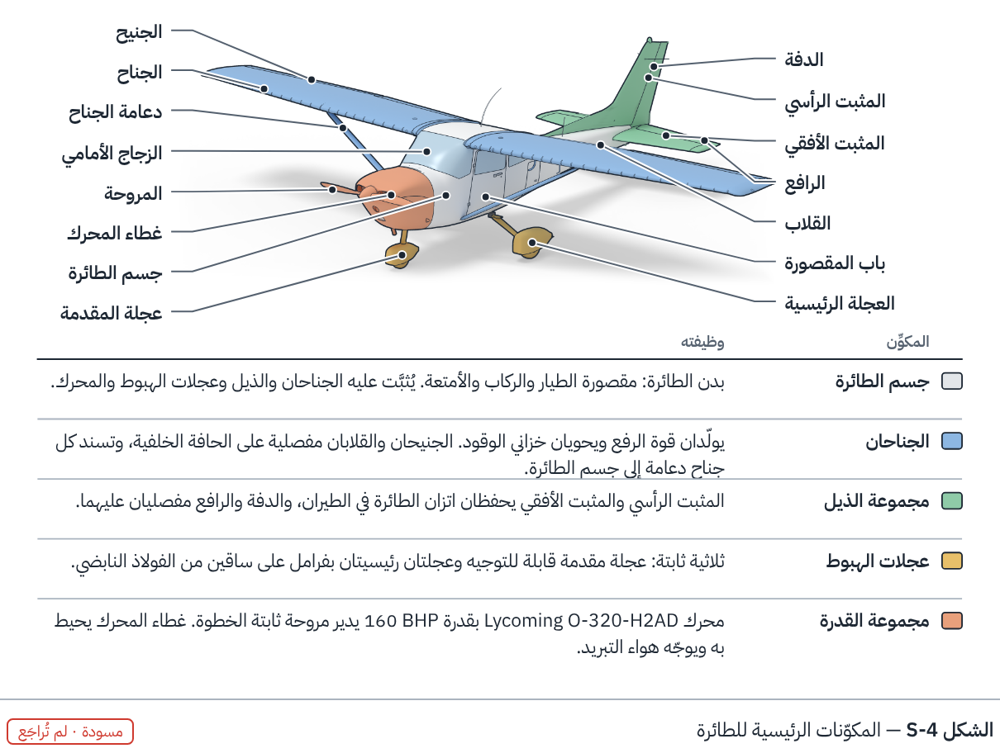
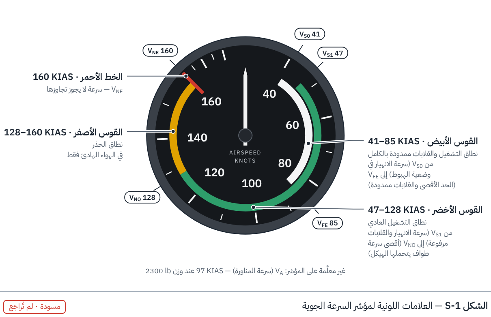
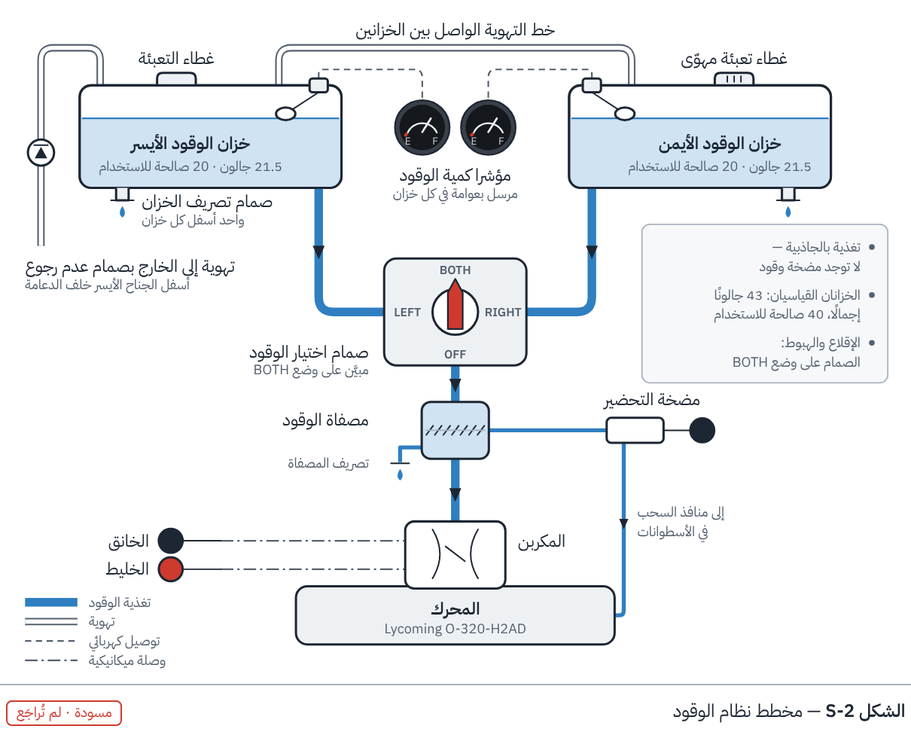
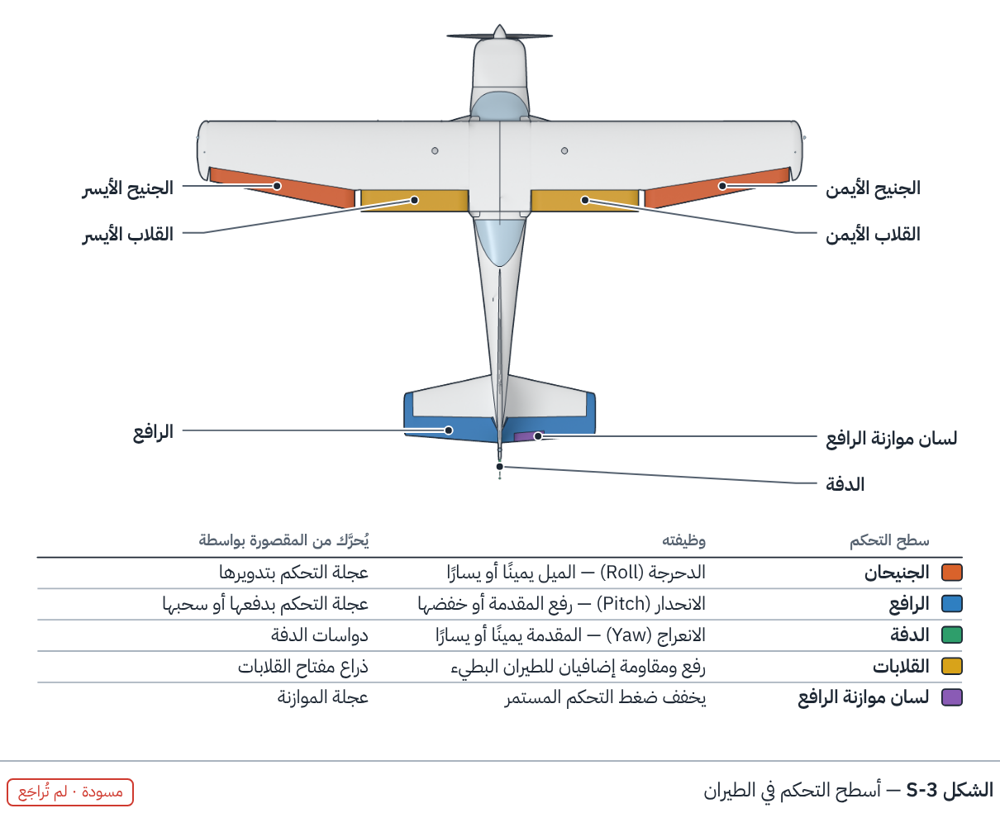
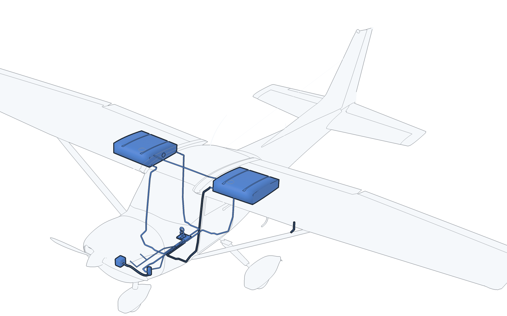

# المرحلة 9 — أشكال الكتاب

أشكال جاهزة للطباعة لكتاب FlyGACA عن الطائرة Cessna 172N، تُبنى من البيانات نفسها التي يعتمد عليها
المحاكي والمجسم ثلاثي الأبعاد، بالعربية والإنجليزية.

**ابدأ بقراءة [الخطة](PLAN.md)** (بالإنجليزية). [English](README.md)

## خلاصة الخطة

لا تحاول أن تجعل مجسمًا مولَّدًا واحدًا يبدو كصورة فوتوغرافية. استخدم ثلاثة أنواع من الصور، كلٌّ في
موضعه، وبأسلوب بصري واحد:

1. **صور فوتوغرافية للطائرة الحقيقية** حيثما يحتاج القارئ إلى *التعرّف* على شيء في ساحة الوقوف أو في
   المقصورة.
2. **مخططات متجهة (Vector) مبنية من بيانات هذا المستودع** حيثما يحتاج القارئ إلى *فهم* طريقة عمل نظام
   أو قراءة عدّاد.
3. **المجسم ثلاثي الأبعاد مرسومًا كرسم تقني** — ألوان مسطحة وخطوط حبرية مع تلوين الجزء المقصود وتسميته —
   للمناظر التي لا تستطيع الكاميرا التقاطها: المقاطع، والتفكيك، والأنظمة من خلال الهيكل.

سبب أن الطائرة المولَّدة لم تكن تبدو صحيحة هو **الشكل لا الإضاءة ولا الخامات**: كان المجسم يعرف أربعة أبعاد
حقيقية فقط (باع الجناح، الطول، الارتفاع، قطر المروحة)، وكل ما عداها تقديري.

**ما تم:** صُحِّح شكل المجسم على رسم المساقط الثلاثة الصادر عن الشركة الصانعة في دليل التشغيل (المنظر
الجانبي والعلوي والأمامي) وعلى أبعاد المقصورة فيه، فصار يطابق كل بُعد منشور، وأُعيدت كتابة أداة الرسم التقني:
تُستخرج الخطوط من أجزاء المجسم نفسها — خط سميك حول الطائرة، وخط متوسط حيث يلتقي جزءان، وخط رفيع عند
الثنيات — فلا خطوط شاردة ولا رسم يدوي. الشكل ما زال **تقديريًا**: يطابق «طائرة 172» وليس طائرتكم بعينها
بعد، والتفاصيل في `08_realistic_digital_twin/docs/05_shape_reference.md`.



## أربعة نماذج

| | |
|---|---|
|  | **S-1 · عدّاد مرسوم من البيانات.** |
|  | **S-2 · مخطط نظام.** |
|  | **S-3 · رسم تقني من المجسم ثلاثي الأبعاد (مسقط علوي)**، والتسميات توضع آليًا. |
|  | **S-4 · رسم تقني من المجسم ثلاثي الأبعاد (منظر مائل)**، المكوّنات الخمسة الرئيسية ملوَّنة. |

النماذج الأربعة **مسودات** لم تُراجَع بعد على دليل تشغيل الطائرة (POH)، والمصطلحات العربية تحتاج إلى
مراجعة مدرّب طيران.

## أي جزء لوحده

صار المجسم مفصَّلاً إلى ما تحت الجلد: الهيكل الداخلي، وكابلات التحكم، ومكوّنات الأنظمة، وداخل المحرك
وداخل العدادات، والمسامير والبراغي، كلٌّ منها جزء مستقل له اسم ورقم — 1174 جزءًا. أرقام الأجزاء وأسماؤها بالعربية والإنجليزية في
[فهرس الأجزاء](../08_realistic_digital_twin/docs/06_parts_index.md)، وصورة لكل نظام مع الأمر الذي
أنتجها في [الأطلس](atlas/README.md).



```bash
npm run part:list                                                  # قائمة بكل الأجزاء
npm run part -- render --part ENGINE.piston_1                      # جزء واحد مرسوم لوحده
npm run part -- render --part "WING_L.rib_*" --context             # في موضعه: بقية الطائرة شفافة حوله
npm run part -- render --part @fuel_system --context --frame aircraft --grow 0.006 --tint "#3B7DD8"
npm run part -- render --part @altimeter --ghost PANEL.ALT.case --azimuth 50      # آلية العداد وعلبته شفافة حولها
npm run part -- render --part HARDWARE.bolt                        # قطعة عتاد قياسية بحجمها الحقيقي
npm run part -- export --part @aileron_control --out aileron.glb   # الأجزاء نفسها كملف ثلاثي الأبعاد
python3 09_book_figures/atlas.py                                   # إعادة رسم الأطلس
```

تُحفظ الصور في `09_book_figures/parts/` بخلفية شفافة، ومع كل صورة ملف صغير بأسماء الأجزاء التي فيها.

| صيغة الرقم | مثال |
|---|---|
| جزء واحد | `ENGINE.piston_1` |
| مجموعة بكل ما فيها | `WING_L` |
| نمط | `"WING_L.rib_*"` |
| نظام أو آلية كاملة أينما كانت أجزاؤها | `@fuel_system` ، `@aileron_control` ، `@altimeter` ، `@engine_internals` |
| كل أجزاء تصنيف | `system:CONTROLS` ، `system:FASTENERS` |

| خيار | وظيفته |
|---|---|
| `--context` | يرسم بقية الطائرة كخيال شفاف ليعرف القارئ موضع الجزء |
| `--frame aircraft` | يُبقي الطائرة كاملة في الصورة |
| `--ghost` | يرسم أجزاء محددة كخيال شفاف: علبة العداد حول آليته، أو الأسطوانة حول مكبسها وصماماتها |
| `--focus` | يضبط الإطار على أجزاء محددة مع رسم كل الأجزاء المذكورة |
| `--azimuth` و `--elevation` | اتجاه النظر بالدرجات (0 من الأمام، 90 من يسار الطائرة، 180 من الخلف) |
| `--tint "#RRGGBB"` | يلوّن الأجزاء |
| `--grow 0.006` | يرسم الكابلات والأنابيب أسمك لتظهر والطائرة كاملة في الصورة |

مستويات التفصيل: 0 المجسم الأساسي، 1 ما تحت الجلد، 2 المسامير والبراغي وطقم العتاد القياسي.
ما بُني من دليل التشغيل وما هو تقريبي مذكور في
[`07_under_the_skin.md`](../08_realistic_digital_twin/docs/07_under_the_skin.md) (بالإنجليزية).
المواضع والمقاسات والمسارات تقريبية: تصلح لشرح بنية الطائرة وطريقة عمل الأنظمة، وليست مرجعًا للصيانة.

## البناء

```bash
npm ci
npm run figures           # كل الأشكال باللغتين -> 09_book_figures/out/
npm run figures:render    # إعادة تصيير الرسوم ثلاثية الأبعاد في Blender
npm run figures:check     # بناء تجريبي يفشل إذا خرج أي نص عن حدود الشكل
npm test
```

- `out/<lang>/<id>.pdf` — ملف الطباعة (متجه، بالمقاس الدقيق، الخطوط مضمَّنة).
- `out/<lang>/<id>.svg` — ملف متجه قابل للتعديل.
- `out/preview/<id>.<lang>.png` — ورقة مراجعة مع رقم الشكل وعنوانه وحالة المراجعة.

## تنبيه

هذه مواد تعليمية تقريبية وليست معتمدة للطيران أو الصيانة. المرجع هو دليل التشغيل (POH/AFM) الخاص
بالطائرة ومدرّبك.
