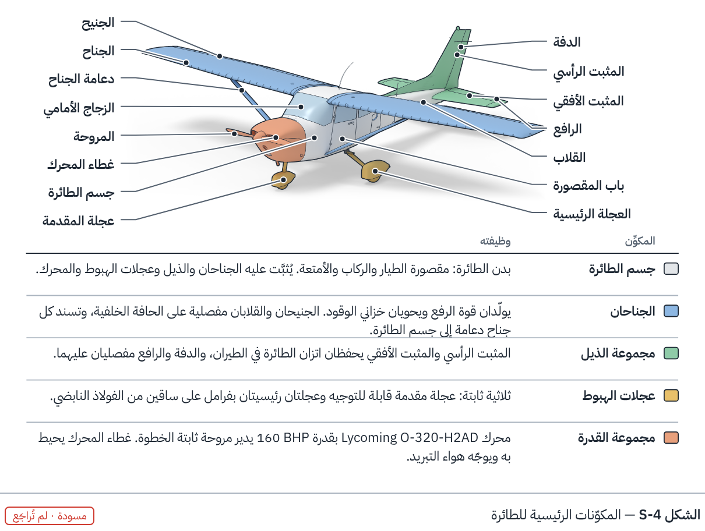
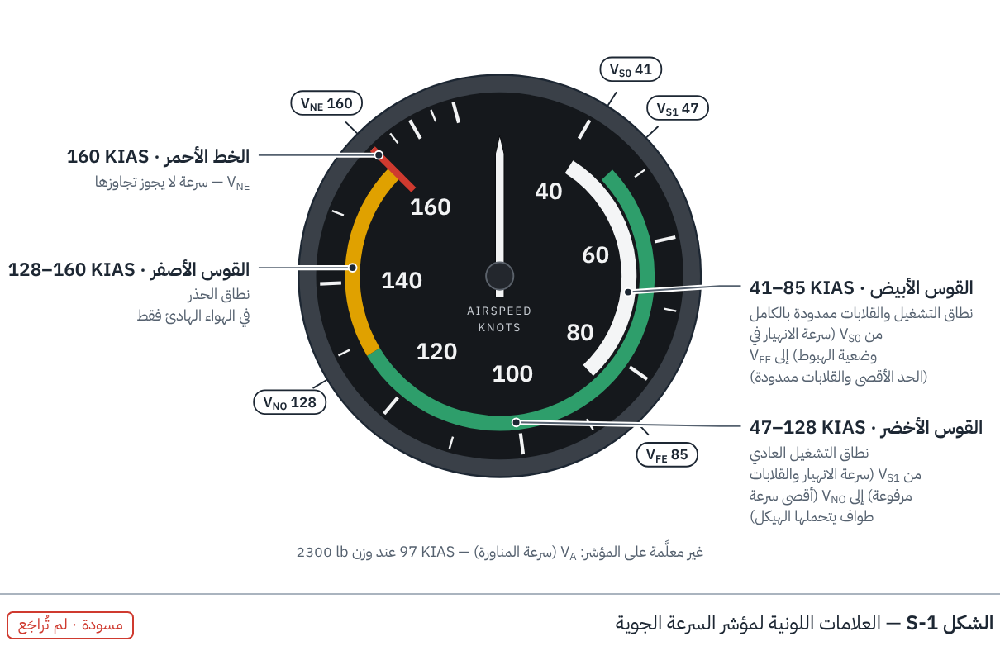
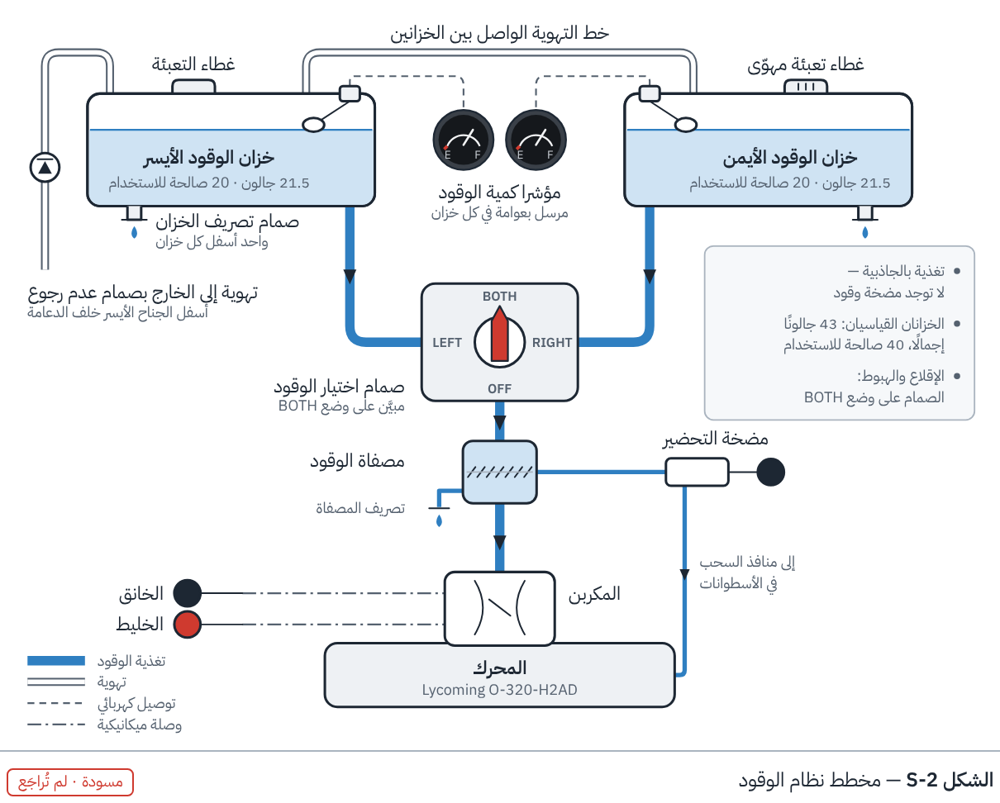
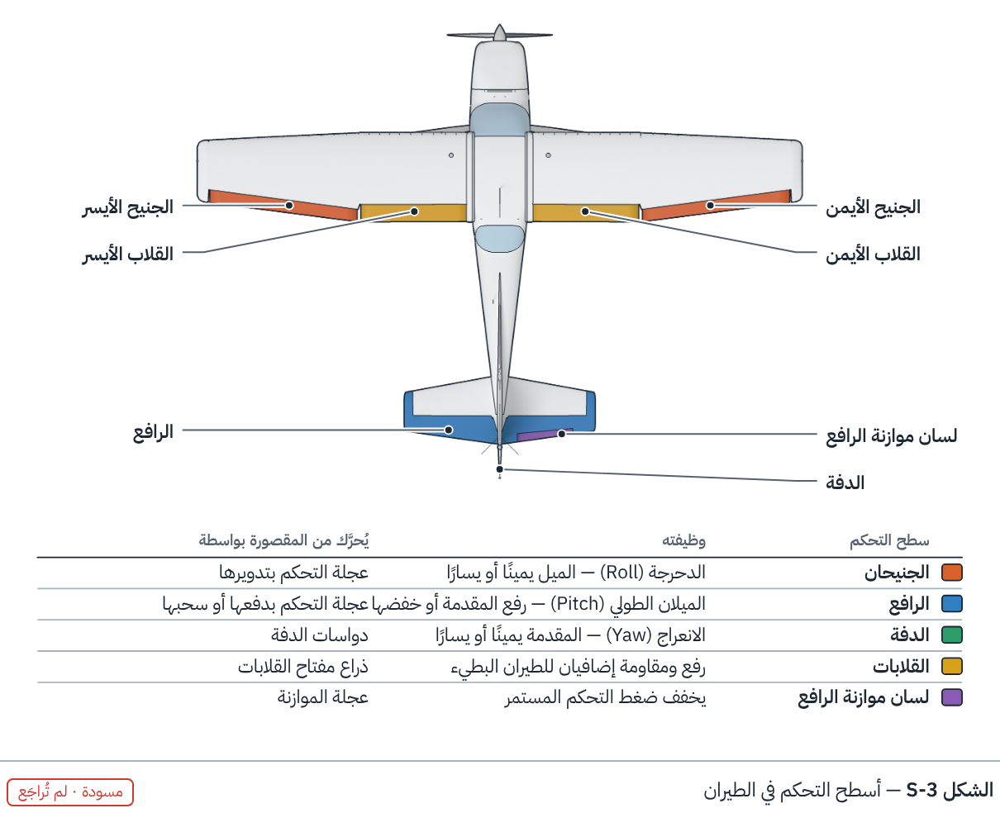
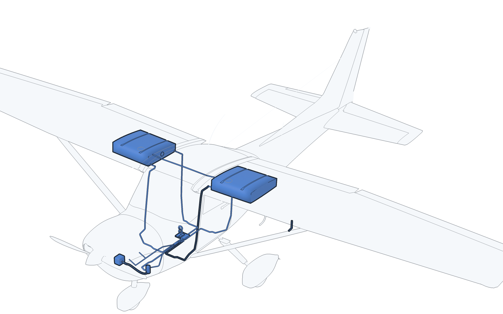

# المرحلة 9 — أشكال الكتاب

أشكال جاهزة للطباعة لكتاب FlyGACA عن الطائرة Cessna 172N، تُبنى من البيانات نفسها التي يعتمد عليها
المحاكي والمجسم ثلاثي الأبعاد، بالعربية والإنجليزية.

**ابدأ بقراءة [الخطة](PLAN.md)** (بالإنجليزية). [English](README.md)

## خلاصة الخطة

لا تحاول أن تجعل مجسمًا مولَّدًا واحدًا يبدو كصورة فوتوغرافية. استخدم ثلاثة أنواع من الصور، كلٌّ في
موضعه، وبأسلوب بصري واحد:

1. **صور فوتوغرافية للطائرة الحقيقية** حيثما يحتاج القارئ إلى *التعرّف* على شيء في ساحة الوقوف أو في
   المقصورة.
2. **مخططات متجهة (Vector) مبنية من بيانات هذا المستودع** حيثما يحتاج القارئ إلى *فهم* طريقة عمل نظام
   أو قراءة عدّاد.
3. **المجسم ثلاثي الأبعاد مرسومًا كرسم تقني** — ألوان مسطحة وخطوط حبرية مع تلوين الجزء المقصود وتسميته —
   للمناظر التي لا تستطيع الكاميرا التقاطها: المقاطع، والتفكيك، والأنظمة من خلال الهيكل.

سبب أن الطائرة المولَّدة لم تكن تبدو صحيحة هو **الشكل لا الإضاءة ولا الخامات**: كان المجسم يعرف أربعة أبعاد
حقيقية فقط (باع الجناح، الطول، الارتفاع، قطر المروحة)، وكل ما عداها تقديري.

**ما تم:** صُحِّح شكل المجسم على رسم المساقط الثلاثة الصادر عن الشركة الصانعة في دليل التشغيل (المنظر
الجانبي والعلوي والأمامي) وعلى أبعاد المقصورة فيه، فصار يطابق كل بُعد منشور، وأُعيدت كتابة أداة الرسم التقني:
تُستخرج الخطوط من أجزاء المجسم نفسها — خط سميك حول الطائرة، وخط متوسط حيث يلتقي جزءان، وخط رفيع عند
الثنيات — فلا خطوط شاردة ولا رسم يدوي. الشكل ما زال **تقديريًا**: يطابق «طائرة 172» وليس طائرتكم بعينها
بعد، والتفاصيل في `08_realistic_digital_twin/docs/05_shape_reference.md`.



## أربعة نماذج

| | |
|---|---|
|  | **S-1 · عدّاد مرسوم من البيانات.** |
|  | **S-2 · مخطط نظام.** |
|  | **S-3 · رسم تقني من المجسم ثلاثي الأبعاد (مسقط علوي)**، والتسميات توضع آليًا. |
|  | **S-4 · رسم تقني من المجسم ثلاثي الأبعاد (منظر مائل)**، المكوّنات الخمسة الرئيسية ملوَّنة. |

النماذج الأربعة **مسودات** لم تُراجَع بعد على دليل تشغيل الطائرة (POH)، والمصطلحات العربية تحتاج إلى
مراجعة مدرّب طيران.

## أي جزء لوحده

صار المجسم مفصَّلاً إلى ما تحت الجلد: الهيكل الداخلي، وكابلات التحكم، ومكوّنات الأنظمة، وداخل المحرك
وداخل العدادات، والمسامير والبراغي، كلٌّ منها جزء مستقل له اسم ورقم — 1198 جزءًا. أرقام الأجزاء وأسماؤها بالعربية والإنجليزية في
[فهرس الأجزاء](../08_realistic_digital_twin/docs/06_parts_index.md)، وصورة لكل نظام مع الأمر الذي
أنتجها في [الأطلس](atlas/README.md).



```bash
npm run part:list                                                  # قائمة بكل الأجزاء
npm run part -- render --part ENGINE.piston_1                      # جزء واحد مرسوم لوحده
npm run part -- render --part "WING_L.rib_*" --context             # في موضعه: بقية الطائرة شفافة حوله
npm run part -- render --part @fuel_system --context --frame aircraft --grow 0.006 --tint "#3B7DD8"
npm run part -- render --part @altimeter --ghost PANEL.ALT.case --azimuth 50      # آلية العداد وعلبته شفافة حولها
npm run part -- render --part HARDWARE.bolt                        # قطعة عتاد قياسية بحجمها الحقيقي
npm run part -- export --part @aileron_control --out aileron.glb   # الأجزاء نفسها كملف ثلاثي الأبعاد
python3 09_book_figures/atlas.py                                   # إعادة رسم الأطلس
```

ولكل جزء مكانه في [فهرس القطع المصوَّر](parts/index.html): الجزء لوحده، والجزء ملوَّنًا في موضعه داخل
الطائرة الشفافة، وعرض ثلاثي الأبعاد يمكن تدويره وتقريبه. يعرض العرض ثلاثي الأبعاد الجزء لوحده، أو مع نظامه، أو داخل
الطائرة كاملة، حيث يُختار أي جزء بالنقر عليه ويمكن إخفاء أنظمة كاملة لرؤية ما تحتها، ومنزلق يفكّك الأجزاء عن بعضها. ويقدّم «حرّكها كما في الطائرة الحقيقية» منزلقًا لكل أداة تحكم (الجنيحات وعجلتا القيادة، ذيل الارتفاع، الدفة مع الدواسات وعجلة الأنف، الضبط، القلابات، الأبواب الثلاثة، الغطاء العلوي للمحرك)، وإدارة المحرك باليد (عمود المرفق والمروحة والمكابس وأذرع التوصيل والصمامات وعمود الحدبات بترتيب الإشعال 1-3-2-4)، والأذرع والمقابض تحت لوحة العدادات، ومفتاح الإشعال، ومحدد الوقود، ومفاتيح اللوحة، وكل منزلق يحرّك كل جزء يتحرك معه في الطائرة حول مفصل ذلك الجزء أو محوره، كما في عارض المرحلة الثامنة. أما «اسحب قطعة» فتحرّك أي قطعة منفردة في المستوى المواجه للقارئ أو في العمق، و«أعد كل شيء إلى مكانه» يتراجع عن الاثنين. تأتي أدوات التحكم في تبويبات (المشهد، أدوات الطيران والأبواب، المحرك، الأذرع والمقابض، المفاتيح، العدادات) فتُظهر الهاتف عددًا قليلًا منها في كل مرة؛ وزر «شغّل المحرك» في تبويب المحرك يُدير عمود المرفق وحده بالسرعة المختارة ويسمّي الشوط الذي تمرّ به كل أسطوانة (سحب، انضغاط، قدرة، عادم). وعند ضبط أي عداد (السرعة، الارتفاع، السرعة الرأسية، الاتجاه، الميل الجانبي والطولي، معدل الدوران، سرعة المحرك، ضغط الزيت وحرارته، الشفط، مقياس التيار، الوقود في كل خزان) تنتقل كل المؤشرات إلى قراءاتها بالمقاييس نفسها المستخدمة في عدادات عارض المرحلة الثامنة. وتُضاء المصابيح (المنارة وأضواء الملاحة وضوء الهبوط والأضواء الومضية) عند رفع مفتاحها ومفتاح البطارية، (تومض المنارة والأضواء الومضية بتوقيت عارض المرحلة الثامنة، وتبقى ثابتة لمن يفضّل تقليل الحركة؛ والتوهج أضعف من العارض لأن هذا العرض بلا توهّج إضافي)، وتتوهج شمعة الإشعال لحظة إشعالها حين يكون مفتاح الإشعال مفعّلًا والمحرك يُدار باليد. وتضبط قائمة «المشهد» أدوات التحكم والعدادات معًا على حالة تستحق المعاينة (متوقفة، تشغيل المحرك، فحص المحرك، الإقلاع، الطيران المستوي، الاقتراب النهائي). القيم نموذجية للتوضيح وليست من دليل POH، والطائرة موضوعة في وضع وليست محلَّقة: لا شيء يضبط القراءات سواك أو سوى المشهد. أما ضوء التاكسي فلا مصباح له في النموذج، فيتحرك مفتاحه دون أن يُضيء شيئًا.

لكل جزء عنوانه الخاص: `parts/index.html?part=ENGINE.piston_1`، ويمكن إضافة `&view=alone|place|3d` وفي العرض ثلاثي الأبعاد
`&scope=part|system|aircraft`. وفي العرض ثلاثي الأبعاد يحمل العنوان أيضًا الوضعية: `&pose=flaps:30,doorL:1,crank:90` يسرد أدوات التحكم الخارجة عن وضع الراحة (المفاتيح 1 للأعلى و-1 للأسفل)، و`&moved=ENGINE.piston_1:0.01:0:-0.02` الأجزاء التي سحبها القارئ بالمتر. وأي قيمة خاطئة تُترك ويُطبَّق الباقي. تُبقي الصفحة العنوان محدَّثًا ما دام جزء مفتوحًا، وزر «انسخ رابط هذه القطعة» ينسخه مع الوضعية. أسماء
الأجزاء هي نفسها في رابط `?part=` الخاص بعارض المرحلة 8، وفي معلومات الجزء داخل العارض الآن رابط إلى الجزء نفسه في الفهرس. يُبنى على خطوتين، والأولى تحتاج Blender ونحو أربع
عشرة ساعة على أربعة أنوية:

```bash
python3 09_book_figures/parts/render_all.py --out /path/to/renders   # كل جزء مرتين، ونموذج لكل نظام (لا تُحفظ في المستودع)
python3 09_book_figures/parts/build.py --renders /path/to/renders    # يجمعها في parts/ وينسخ الصور بالحجم الكامل إلى parts/full/ (يحتاج Pillow)
```


تُحفظ الصور في `09_book_figures/parts/` بخلفية شفافة، ومع كل صورة ملف صغير بأسماء الأجزاء التي فيها.

| صيغة الرقم | مثال |
|---|---|
| جزء واحد | `ENGINE.piston_1` |
| مجموعة بكل ما فيها | `WING_L` |
| نمط | `"WING_L.rib_*"` |
| نظام أو آلية كاملة أينما كانت أجزاؤها | `@fuel_system` ، `@aileron_control` ، `@altimeter` ، `@engine_internals` |
| كل أجزاء تصنيف | `system:CONTROLS` ، `system:FASTENERS` |

| خيار | وظيفته |
|---|---|
| `--context` | يرسم بقية الطائرة كخيال شفاف ليعرف القارئ موضع الجزء |
| `--frame aircraft` | يُبقي الطائرة كاملة في الصورة |
| `--ghost` | يرسم أجزاء محددة كخيال شفاف: علبة العداد حول آليته، أو الأسطوانة حول مكبسها وصماماتها |
| `--focus` | يضبط الإطار على أجزاء محددة مع رسم كل الأجزاء المذكورة |
| `--azimuth` و `--elevation` | اتجاه النظر بالدرجات (0 من الأمام، 90 من يسار الطائرة، 180 من الخلف) |
| `--tint "#RRGGBB"` | يلوّن الأجزاء |
| `--grow 0.006` | يرسم الكابلات والأنابيب أسمك لتظهر والطائرة كاملة في الصورة |

مستويات التفصيل: 0 المجسم الأساسي، 1 ما تحت الجلد، 2 المسامير والبراغي وطقم العتاد القياسي.
ما بُني من دليل التشغيل وما هو تقريبي مذكور في
[`07_under_the_skin.md`](../08_realistic_digital_twin/docs/07_under_the_skin.md) (بالإنجليزية).
المواضع والمقاسات والمسارات تقريبية: تصلح لشرح بنية الطائرة وطريقة عمل الأنظمة، وليست مرجعًا للصيانة.

## البناء

```bash
npm ci
npm run figures           # كل الأشكال باللغتين -> 09_book_figures/out/
npm run figures:render    # إعادة تصيير الرسوم ثلاثية الأبعاد في Blender
npm run figures:check     # بناء تجريبي يفشل إذا خرج أي نص عن حدود الشكل
npm test
```

- `out/<lang>/<id>.pdf` — ملف الطباعة (متجه، بالمقاس الدقيق، الخطوط مضمَّنة).
- `out/<lang>/<id>.svg` — ملف متجه قابل للتعديل.
- `out/preview/<id>.<lang>.png` — ورقة مراجعة مع رقم الشكل وعنوانه وحالة المراجعة.

## تنبيه

هذه مواد تعليمية تقريبية وليست معتمدة للطيران أو الصيانة. المرجع هو دليل التشغيل (POH/AFM) الخاص
بالطائرة ومدرّبك.
