# Atlas: what lies under the skin

One picture of each assembly, drawn by the part tool. Written by `09_book_figures/atlas.py`; do not edit by hand.
These are drafts for choosing views, without labels. Under each picture is the command that made it:
change the ids, the direction (`--azimuth`, `--elevation`) or the tint and you have your own.
The ids are in `08_realistic_digital_twin/docs/06_parts_index.md`.

## Wing structure: spars, ribs, stringers, fittings

<div dir="rtl">هيكل الجناح: العوارض والأضلاع والدعامات الطولية وتجهيزات الربط</div>

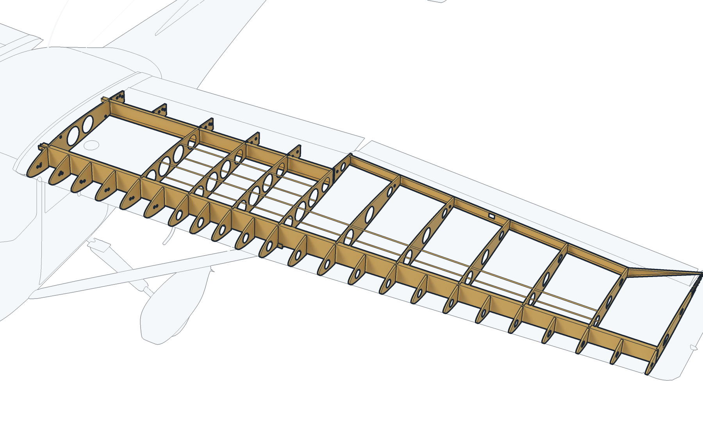

```
npm run part -- render --part WING_L.front_spar WING_L.rear_spar WING_L.aileron_spar 'WING_L.rib_*' 'WING_L.nose_rib_*' 'WING_L.stringer_*' 'WING_L.spar_fitting_*' WING_L.strut_fitting --context --azimuth 28 --elevation 42 --tint '#D4A84B' --margin 0.62
```

## Fuselage structure: frames, door posts, carry-through spars, floor structure, stringers

<div dir="rtl">هيكل جسم الطائرة: الإطارات وقوائم الأبواب والعوارض العابرة وهيكل الأرضية والدعامات الطولية</div>

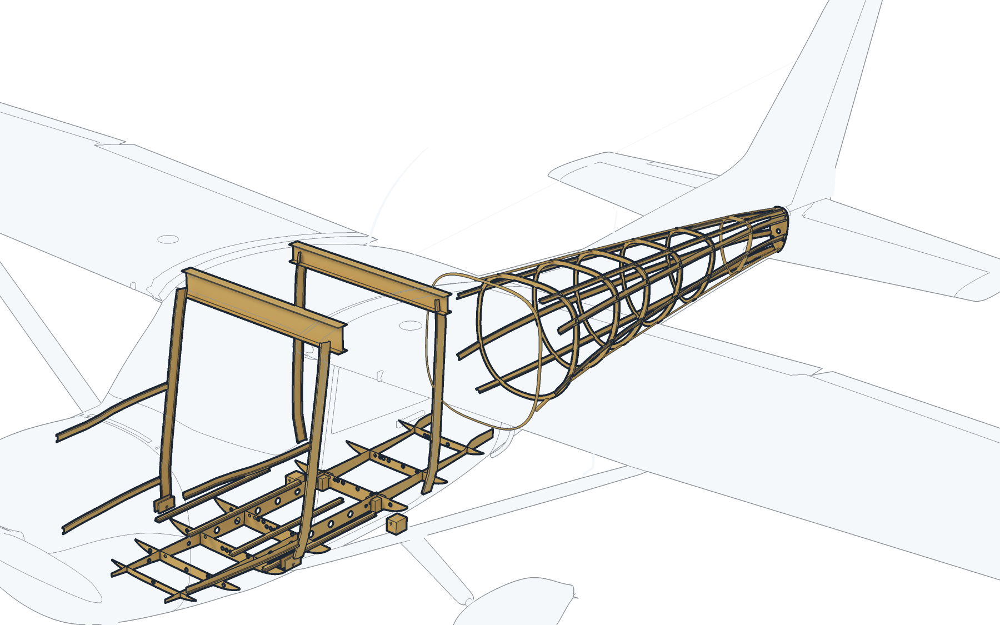

```
npm run part -- render --part 'AIRFRAME.frame_*' 'AIRFRAME.door_post_*' 'AIRFRAME.carry_through_*' 'AIRFRAME.floor_*' 'AIRFRAME.keel_beam_*' 'AIRFRAME.stringer_tail_*' 'AIRFRAME.engine_mount_stringer_*' 'AIRFRAME.seat_rail_*' 'AIRFRAME.strut_attach_plate_*' 'AIRFRAME.gear_forging_*' --context --azimuth 40 --elevation 24 --tint '#D4A84B' --margin 0.6
```

## Tail structure: spars, ribs, hinges, balance weights, torque tube

<div dir="rtl">هيكل الذيل: العوارض والأضلاع والمفصلات وأثقال الموازنة وأنبوب العزم</div>

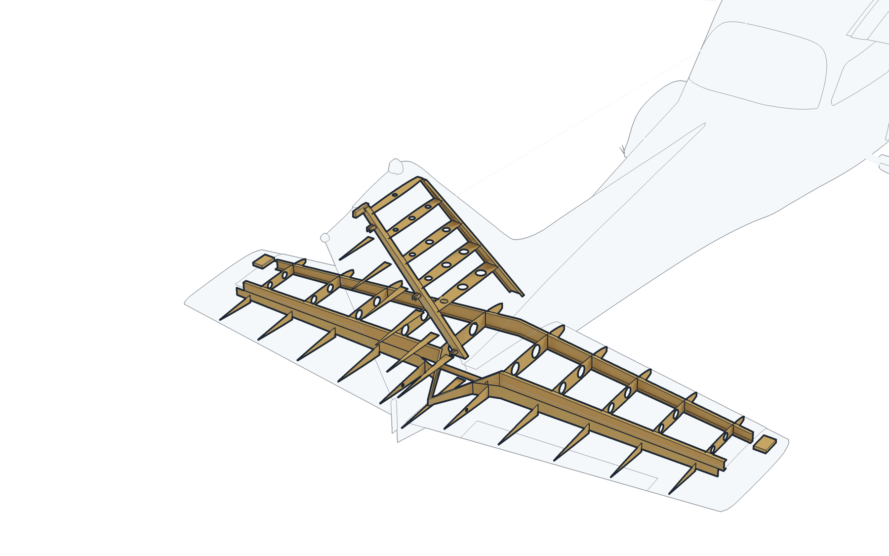

```
npm run part -- render --part 'EMPENNAGE.fin_*' 'EMPENNAGE.rudder_rib_*' 'EMPENNAGE.rudder_hinge_*' EMPENNAGE.rudder_balance_weight 'EMPENNAGE.stabilizer_*' 'EMPENNAGE.elevator_rib_*' 'EMPENNAGE.elevator_spar_*' 'EMPENNAGE.elevator_balance_weight_*' EMPENNAGE.elevator_torque_tube --context --azimuth 215 --elevation 30 --tint '#D4A84B' --margin 0.75
```

## Flight controls: ailerons, elevator, rudder, trim and nose-wheel steering

<div dir="rtl">أنظمة التحكم بالطيران: الجنيحات والرافع والدفة والموازنة وتوجيه عجلة المقدمة</div>

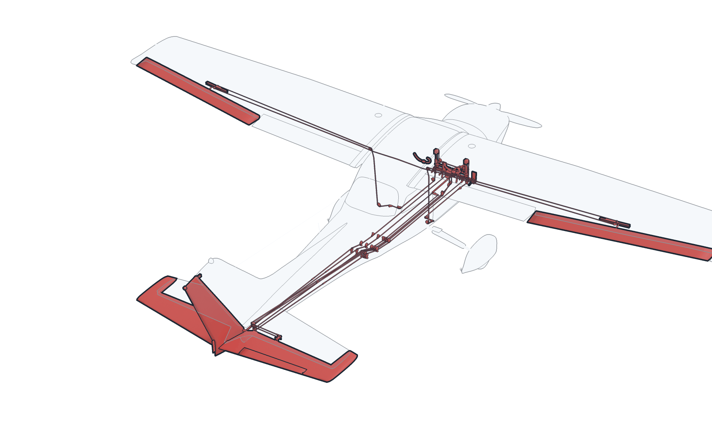

```
npm run part -- render --part @aileron_control @elevator_control @rudder_control @elevator_trim @nose_steering --context --frame aircraft --azimuth 215 --elevation 32 --grow 0.006 --tint '#D9534F' --margin 0.56
```

## Behind the instrument panel: control column, chains, rudder bars

<div dir="rtl">خلف لوحة العدادات: عمود القيادة والسلاسل وقضيبا الدفة</div>

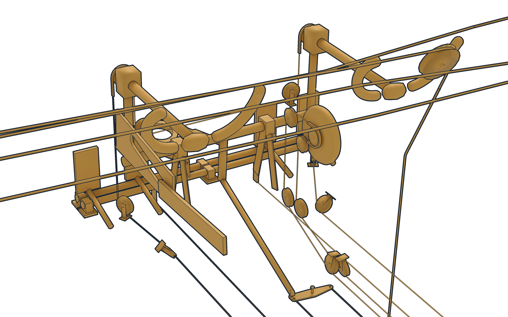

```
npm run part -- render --part system:CONTROLS 'INTERIOR.yoke_*' 'INTERIOR.pedal_*' INTERIOR.trim_wheel --focus CONTROLS.control_column CONTROLS.rudder_bar_fwd CONTROLS.elevator_bellcrank_fwd CONTROLS.trim_chain --azimuth 150 --elevation 28 --tint '#D9A441' --margin 0.75
```

## Under the cabin floor: cables and pulleys through the bulkheads and keel beams

<div dir="rtl">تحت أرضية المقصورة: الكابلات والبكرات عبر الحواجز والعوارض الطولية</div>

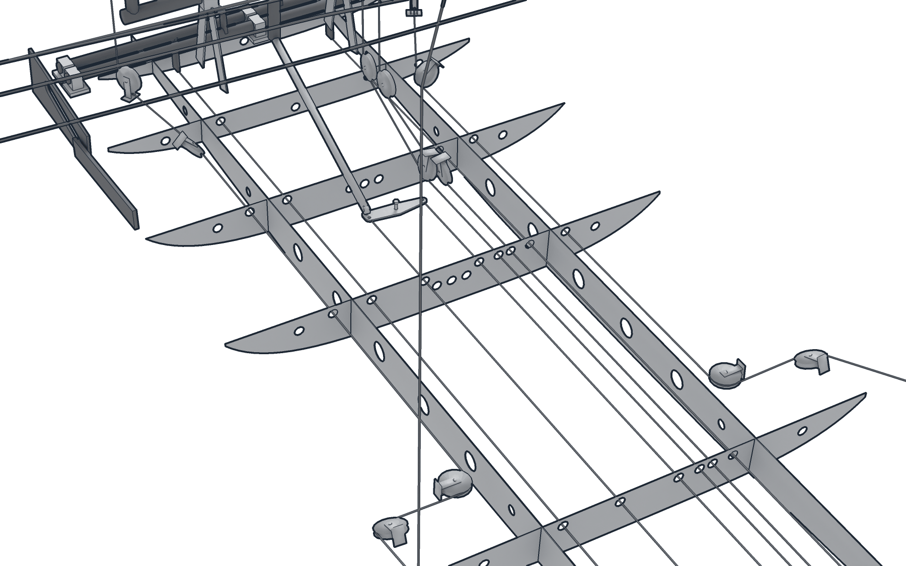

```
npm run part -- render --part system:CONTROLS 'AIRFRAME.floor_*' 'AIRFRAME.keel_beam_*' --focus AIRFRAME.floor_frame_fs041 AIRFRAME.floor_bulkhead_strut AIRFRAME.floor_frame_fs017 AIRFRAME.floor_bulkhead_gear --azimuth 150 --elevation 38 --margin 0.66
```

## At the tail: elevator bellcrank and horn, rudder horn, trim actuator

<div dir="rtl">عند الذيل: الذراع المرفقي وقرن الرافع، قرن الدفة، مشغّل الموازنة</div>

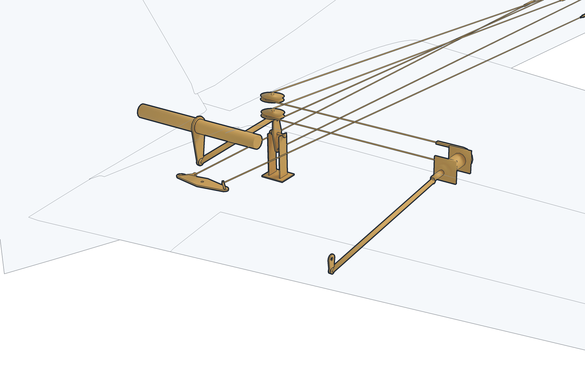

```
npm run part -- render --part system:CONTROLS EMPENNAGE.elevator_torque_tube --context --focus CONTROLS.elevator_bellcrank_aft EMPENNAGE.trim_actuator EMPENNAGE.rudder_horn EMPENNAGE.trim_tab_horn --azimuth 215 --elevation 24 --tint '#D9A441' --margin 0.85
```

## Flap drive: motor, screw, drive pulleys, cables, push-pull rods, tracks

<div dir="rtl">تحريك القلابات: المحرك واللولب وبكرات التحريك والكابلات وقضبان الدفع والسكك</div>

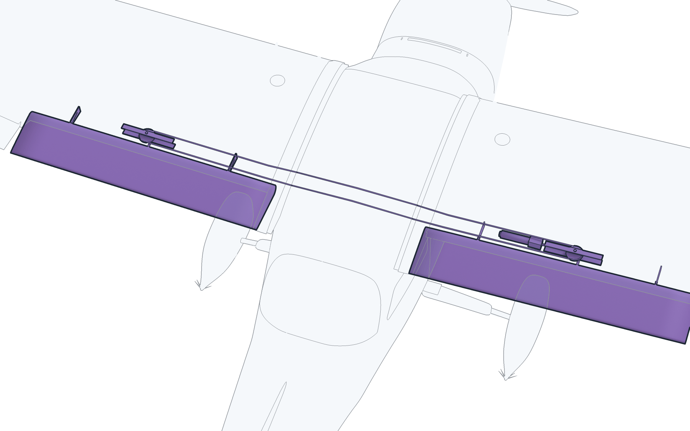

```
npm run part -- render --part @flap_drive --context --azimuth 200 --elevation 50 --grow 0.004 --tint '#8E6BBF' --margin 0.6
```

## Fuel system: tanks, pipes down the door posts, selector valve, strainer, vent, primer

<div dir="rtl">نظام الوقود: الخزانان والأنابيب في قوائم الأبواب وصمام الاختيار والمصفاة والتهوية والتحضير</div>

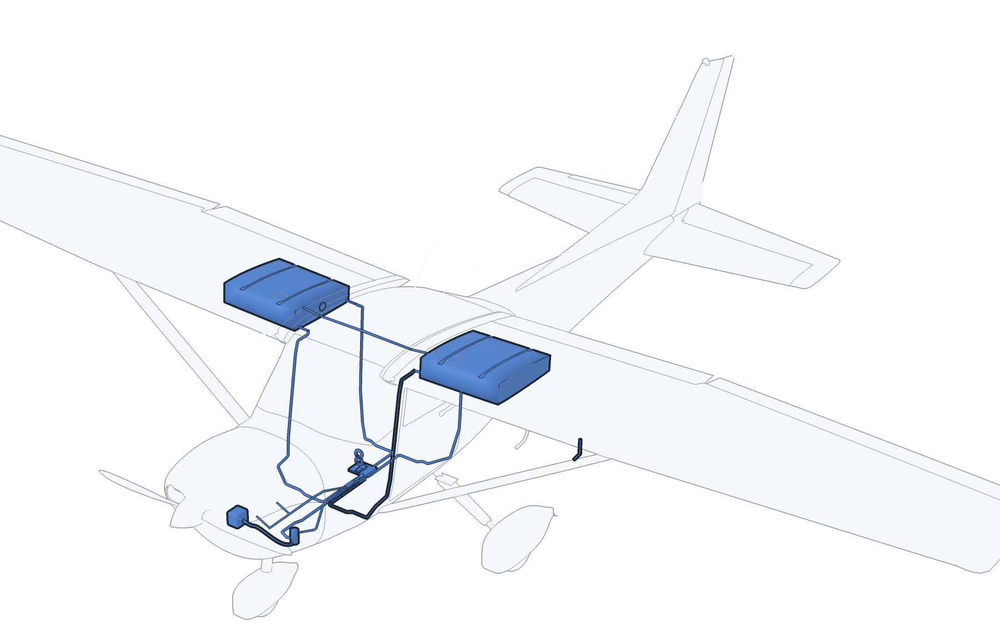

```
npm run part -- render --part @fuel_system --context --frame aircraft --azimuth 35 --elevation 30 --grow 0.006 --tint '#3B7DD8' --margin 0.45
```

## Pitot-static, vacuum and stall warning

<div dir="rtl">أنظمة البيتوت والضغط الساكن والتفريغ وإنذار الانهيار</div>

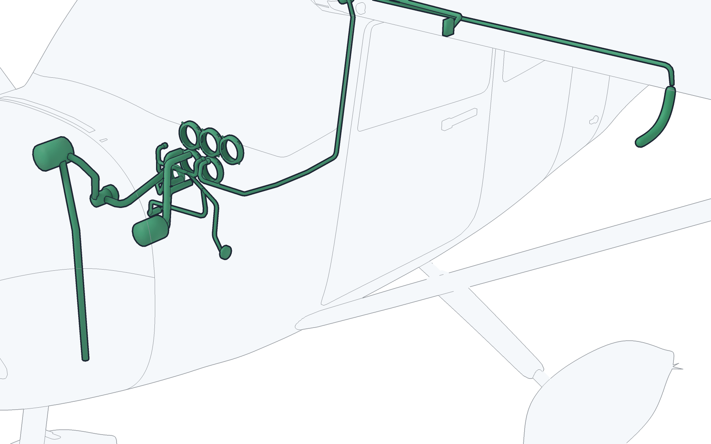

```
npm run part -- render --part @pitot_static @vacuum_system @stall_warning --context --focus PITOT_STATIC.pitot_tube VACUUM.overboard_vent PANEL.VSI.bezel STALL_WARNING.horn --azimuth 40 --elevation 26 --grow 0.004 --tint '#2E9E6B' --margin 0.62
```

## Brakes: master cylinders on the pilot's pedals, pipes to the main wheels

<div dir="rtl">الكوابح: الأسطوانتان الرئيسيتان على دواستي الطيار والأنابيب إلى العجلتين الرئيسيتين</div>

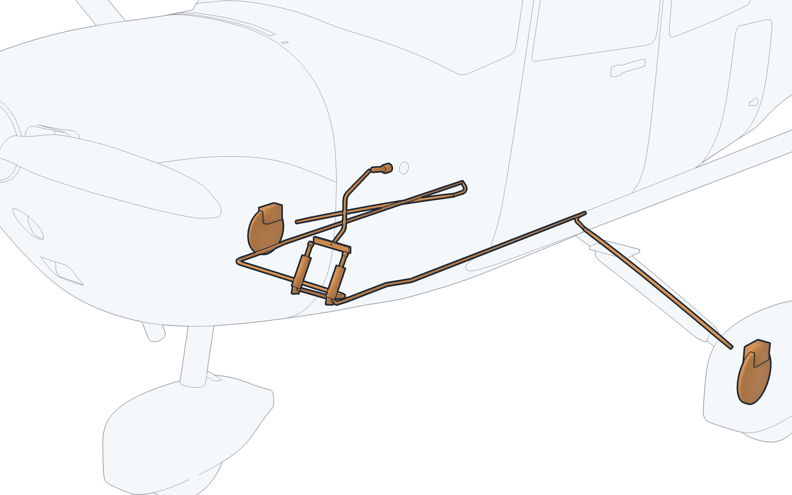

```
npm run part -- render --part @brake_system --context --azimuth 40 --elevation 20 --grow 0.004 --tint '#E08A2E' --margin 0.62
```

## Electrical: battery, contactors, bus bar, heavy cables, wiring to the lights

<div dir="rtl">الكهرباء: البطارية والملامسات وقضيب التوزيع والكابلات الرئيسية وأسلاك الأضواء</div>

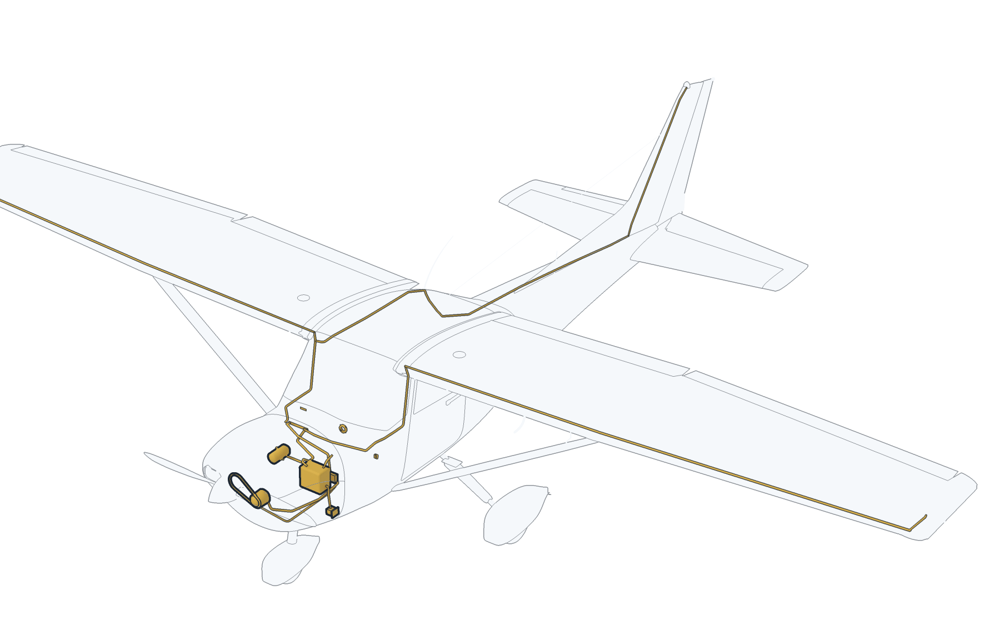

```
npm run part -- render --part @electrical_system --context --frame aircraft --azimuth 35 --elevation 30 --grow 0.006 --tint '#E3B020' --margin 0.5
```

## Inside the engine: crankshaft, camshaft and timing gears, pistons, connecting rods and the valve train of the four cylinders

<div dir="rtl">داخل المحرك: عمود المرفق وعمود الكامات وتروس التوقيت والمكابس وأذرع التوصيل ومجموعة صمامات الأسطوانات الأربع</div>

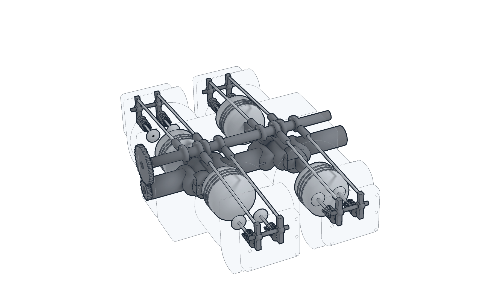

```
npm run part -- render --part @engine_internals --ghost 'ENGINE.crankcase_*' 'ENGINE.cylinder_barrel_*' 'ENGINE.cylinder_head_*' 'ENGINE.rocker_cover_*' 'ENGINE.pushrod_tubes_*' --azimuth 245 --elevation 32 --margin 1.0
```

## Valve train of cylinder 1: cam, tappets, push rods, rocker arms, valves and springs

<div dir="rtl">مجموعة صمامات الأسطوانة 1: الكامة والتوابع وقضبان الدفع والأذرع المتأرجحة والصمامات والنوابض</div>

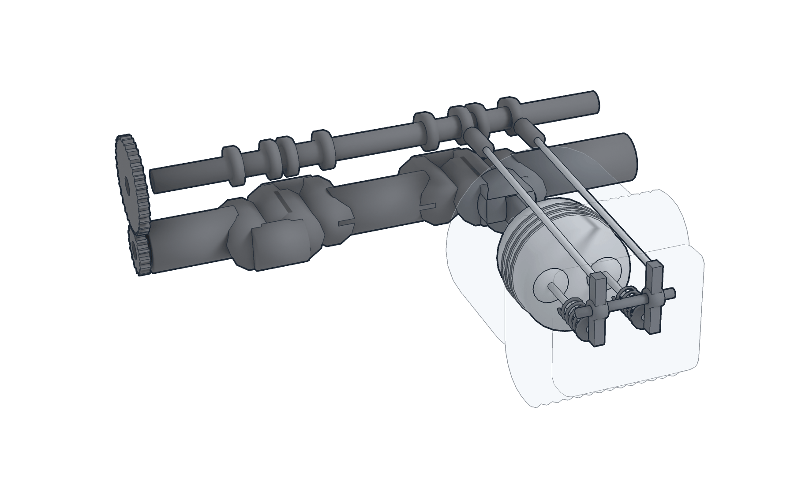

```
npm run part -- render --part ENGINE.camshaft ENGINE.cam_gear ENGINE.crank_gear ENGINE.crankshaft 'ENGINE.tappet_*_1' 'ENGINE.pushrod_*_1' 'ENGINE.rocker_arm_*_1' ENGINE.rocker_shaft_1 'ENGINE.valve_*_1' ENGINE.piston_1 ENGINE.rod_1 ENGINE.piston_pin_1 ENGINE.piston_rings_1 --ghost ENGINE.cylinder_head_1 ENGINE.rocker_cover_1 ENGINE.cylinder_barrel_1 ENGINE.pushrod_tubes_1 --focus ENGINE.rocker_cover_1 ENGINE.cam_gear ENGINE.piston_1 --azimuth 250 --elevation 28 --margin 0.75
```

## Oil system: sump, pump, suction screen, filter, cooler on the firewall and its hoses, valves, breather, gage line

<div dir="rtl">نظام الزيت: الحوض والمضخة ومصفاة السحب والفلتر والمبرّد على جدار الحريق وخراطيمه والصمامات والتنفيس وخط المقياس</div>

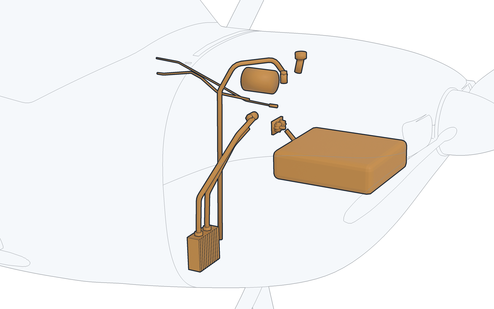

```
npm run part -- render --part @oil_system --context --azimuth 300 --elevation 20 --grow 0.002 --tint '#C9862B' --margin 0.9
```

## Inside the carburetor and the airbox: venturi, throttle valve, nozzle, float, mixture valve, accelerator pump, carburetor heat valve

<div dir="rtl">داخل المكربن وصندوق الهواء: الحلق وصمام الخانق والفوهة والعوامة وصمام الخليط ومضخة التعجيل وصمام تسخين المكربن</div>

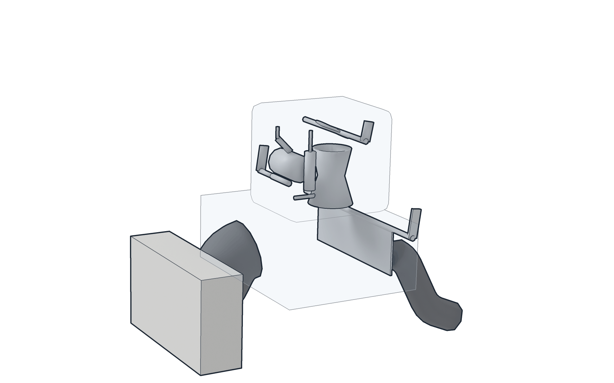

```
npm run part -- render --part @carburetor --ghost INDUCTION.carburetor INDUCTION.airbox --focus INDUCTION.carburetor INDUCTION.airbox --azimuth 60 --elevation 15 --margin 1.3
```

## Engine controls: throttle, mixture and carburetor heat cables from the panel to the carburetor and the airbox

<div dir="rtl">أدوات التحكم بالمحرك: كابلات الخانق والخليط وتسخين المكربن من اللوحة إلى المكربن وصندوق الهواء</div>

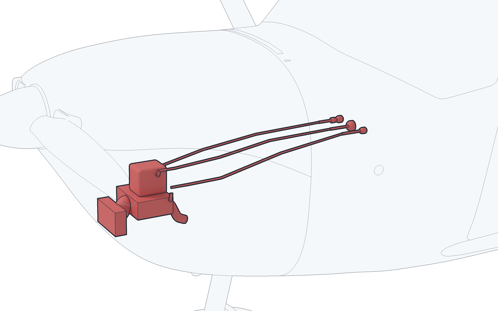

```
npm run part -- render --part @engine_controls @carburetor --context --focus PANEL.throttle INDUCTION.carburetor --azimuth 60 --elevation 20 --grow 0.002 --tint '#D9534F' --margin 1.2
```

## Cabin heating, ventilating and defrosting: muffler shroud, heat hose, heater valve, manifold, defroster, rear ducts, ventilating air door, control cables, the two ventilators with their ducts

<div dir="rtl">تدفئة المقصورة وتهويتها وإزالة الضباب: غلاف كاتم الصوت وخرطوم التدفئة وصمامها والمجمّع ومجرى إزالة الضباب والمجريان الخلفيان وباب هواء التهوية وكابلا التحكم وفتحتا التهوية بمجرييهما</div>

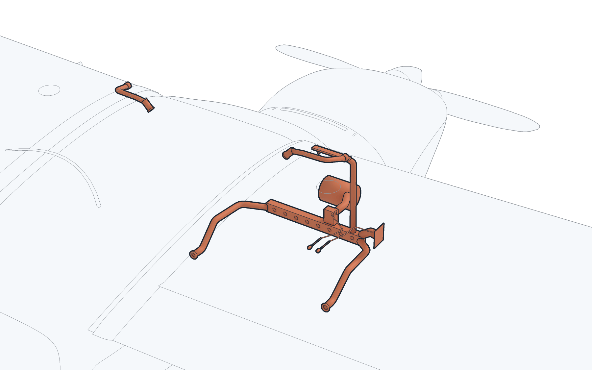

```
npm run part -- render --part @cabin_air --context --focus CABIN_AIR.manifold CABIN_AIR.heat_hose CABIN_AIR.rear_duct_L CABIN_AIR.defroster_outlet CABIN_AIR.ventilator_L AIRFRAME.cabin_vent_R --azimuth 215 --elevation 30 --tint '#E0703A' --margin 1.0
```

## Seats: the front seats on their rails with rollers, seat lock, seat back levers and seat stops; the split-backed rear seat; belts and their anchors

<div dir="rtl">المقاعد: المقعدان الأماميان على سككهما مع البكرات وقفل المقعد وذراعي الظهر والمصدّات؛ المقعد الخلفي بظهرين؛ الأحزمة ومثبتاتها</div>

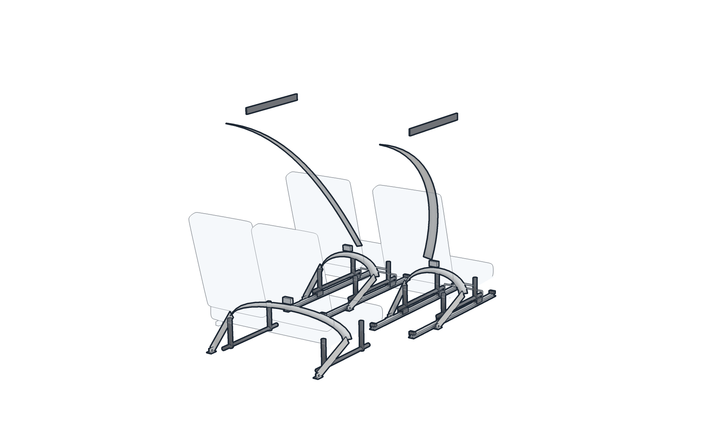

```
npm run part -- render --part @seats 'INTERIOR.shoulder_harness_*' --ghost 'INTERIOR.seat_*.cushion' 'INTERIOR.seat_*.back*' --azimuth 215 --elevation 14 --margin 1.05
```

## Seat lock of the pilot's seat: tubular handle, pins in the rails, rollers, seat back lever, seat stops

<div dir="rtl">قفل مقعد الطيار: المقبض الأنبوبي والمسماران في السكّتين والبكرات وذراع الظهر ومصدّات المقعد</div>

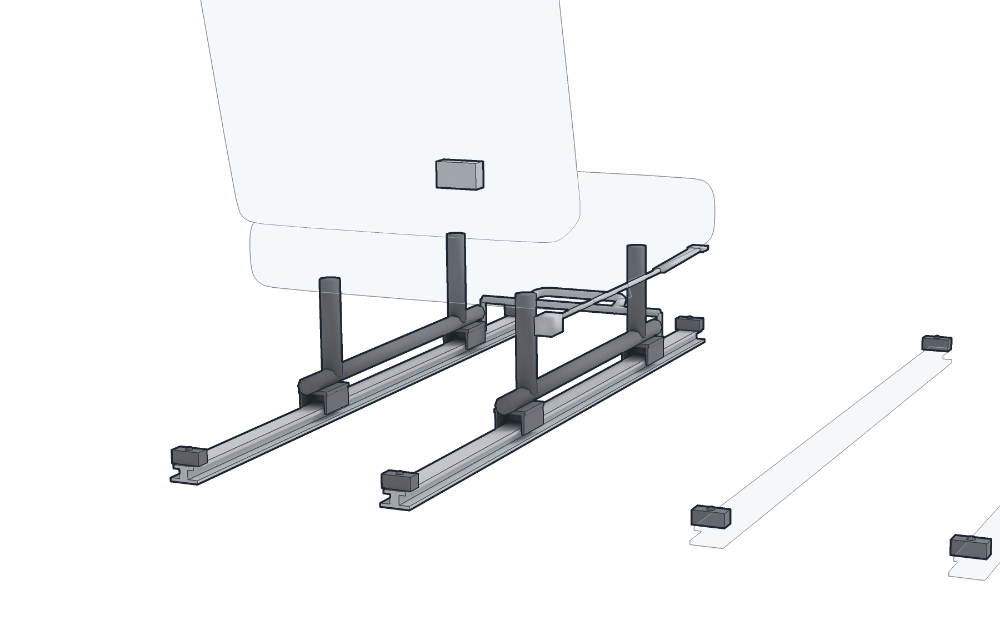

```
npm run part -- render --part 'INTERIOR.seat_pilot.*' 'AIRFRAME.seat_rail_*' AIRFRAME.seat_stops --ghost INTERIOR.seat_pilot.cushion INTERIOR.seat_pilot.back INTERIOR.seat_pilot.lap_belt AIRFRAME.seat_rail_3 AIRFRAME.seat_rail_4 --focus INTERIOR.seat_pilot.frame INTERIOR.seat_pilot.adjust_handle --azimuth 205 --elevation 10 --margin 1.25
```

## Cabin doors: hinges, outside and inside handles, latch, lock (left door), door stop; the openable window with its hinge, latch and retaining arm

<div dir="rtl">بابا المقصورة: المفصلات والمقبضان الخارجي والداخلي والمزلاج والقفل (الباب الأيسر) وآلية الإيقاف؛ النافذة القابلة للفتح بمفصلتها ومزلاجها وذراع تثبيتها</div>

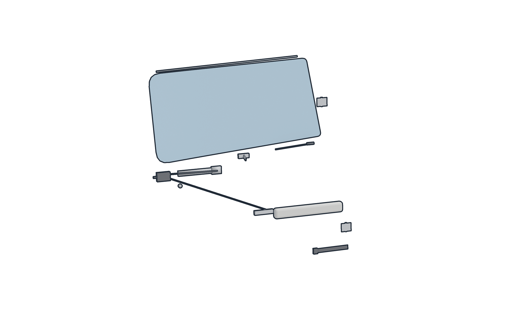

```
npm run part -- render --part AIRFRAME.door_latch_L AIRFRAME.door_lock_L AIRFRAME.door_stop_L 'AIRFRAME.door_window_*_L' AIRFRAME.door_window_L INTERIOR.door_inner_handle_L INTERIOR.armrest_L AIRFRAME.door_handle_L 'AIRFRAME.door_hinge_L_*' --azimuth 250 --elevation 10 --margin 1.1
```

## Baggage area 1 behind the rear seat: baggage net with its eight straps and the tie-down rings

<div dir="rtl">منطقة الأمتعة 1 خلف المقعد الخلفي: شبكة الأمتعة بأشرطتها الثمانية وحلقات الربط</div>

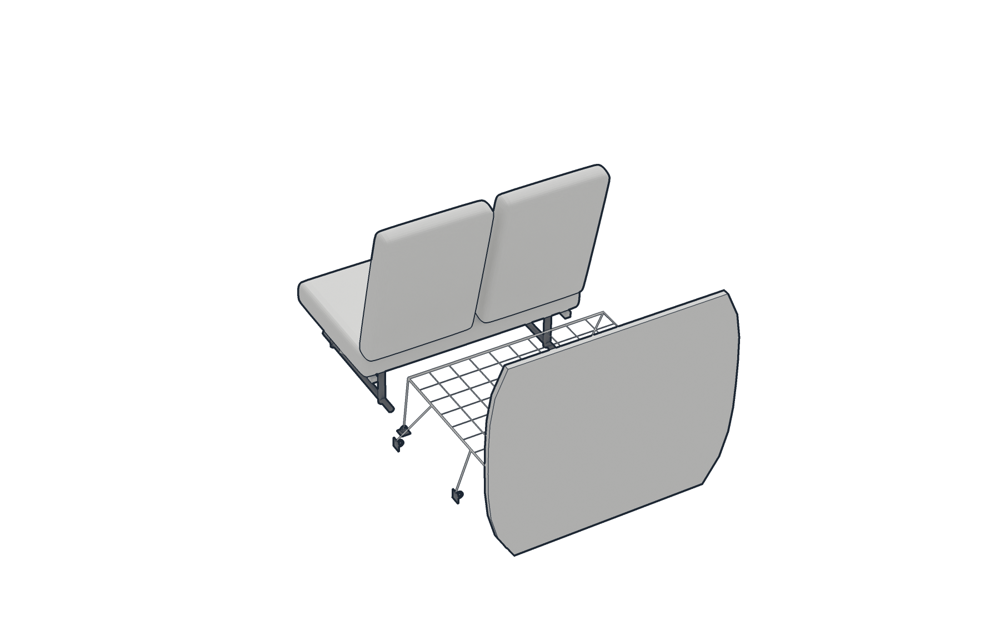

```
npm run part -- render --part @baggage 'INTERIOR.seat_rear.*' INTERIOR.baggage_bulkhead --azimuth 150 --elevation 35 --margin 1.1
```

## Control lock: the rod through the pilot's control wheel shaft and its collar, the red flag over the ignition switch

<div dir="rtl">قفل التحكم: القضيب المار عبر عمود عجلة قيادة الطيار وطوقه، والعلم الأحمر فوق مفتاح الإشعال</div>

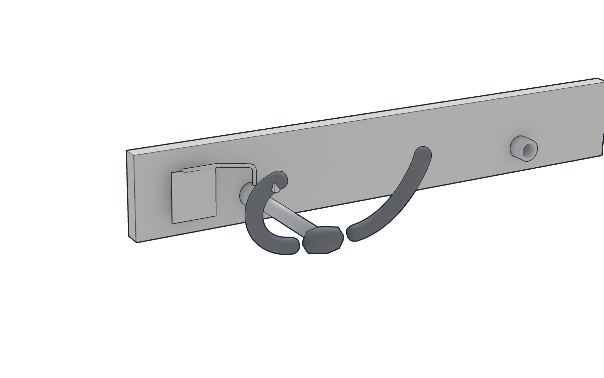

```
npm run part -- render --part INTERIOR.control_lock PANEL.control_wheel_collars INTERIOR.yoke_L INTERIOR.yoke_shaft_L PANEL.ignition_switch PANEL.lower_panel --detail 2 --focus INTERIOR.control_lock INTERIOR.yoke_L --azimuth 150 --elevation 18 --margin 1.2
```

## Lights: navigation, strobe, landing, beacon and tail lights; flood and dome lights in the overhead console; courtesy and map lights

<div dir="rtl">الأضواء: أضواء الملاحة والوميض والهبوط والمنارة والذيل؛ ضوءا إنارة اللوحة والمقصورة في الكونسول العلوي؛ أضواء المجاملة والخرائط</div>

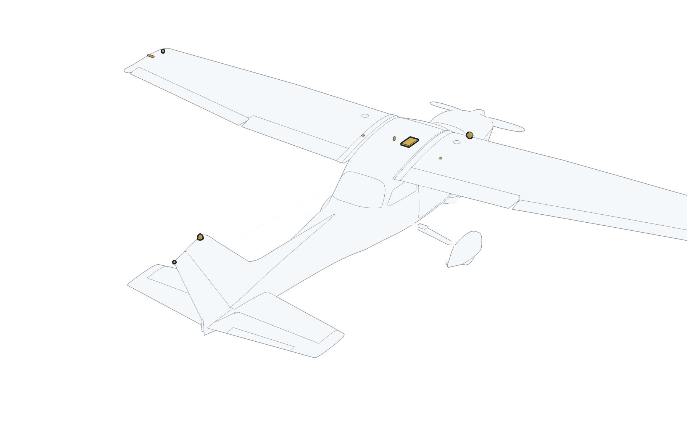

```
npm run part -- render --part @lighting --context --frame aircraft --azimuth 215 --elevation 28 --grow 0.004 --tint '#E3B020' --margin 0.55
```

## Behind the instrument panel: the instrument cases and the pitot, static and vacuum lines joined to them

<div dir="rtl">خلف لوحة العدادات: علب العدادات وخطوط البيتوت والضغط الساكن والتفريغ الموصولة بها</div>

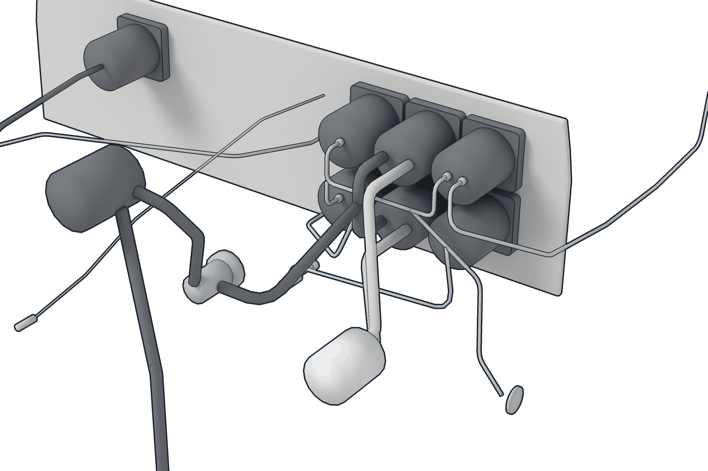

```
npm run part -- render --part @instrument_cases @pitot_static @vacuum_system PANEL.upper_panel PANEL.TACH.drive_cable OIL.pressure_gauge_line OIL.temperature_sensor --focus PANEL.ASI.case PANEL.VSI.case VACUUM.air_filter VACUUM.relief_valve --azimuth 35 --elevation 30 --size 1800x1200 --margin 1.15
```

## Inside the airspeed indicator: capsule, pitot inlet, static port, linkage, sector and pinion

<div dir="rtl">داخل مؤشر السرعة الجوية: الكبسولة ومدخل البيتوت ومنفذ الضغط الساكن والوصلة والقطاع المسنن والترس</div>

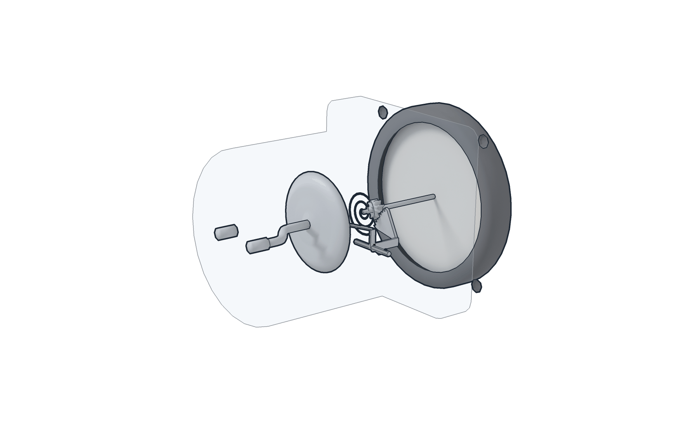

```
npm run part -- render --part @airspeed_indicator --ghost PANEL.ASI.case --azimuth 50 --elevation 18 --margin 1.1
```

## Inside the altimeter: aneroid capsules, linkage, gear train to the three pointers, barometric setting

<div dir="rtl">داخل مقياس الارتفاع: الكبسولات اللاهوائية والوصلة وسلسلة التروس إلى المؤشرات الثلاثة وضبط الضغط الجوي</div>

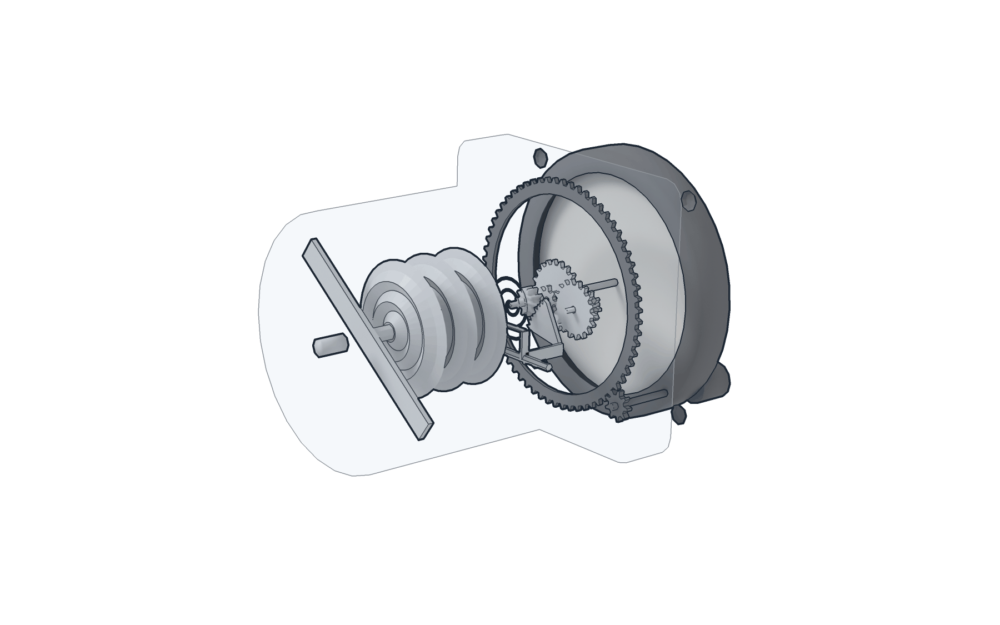

```
npm run part -- render --part @altimeter --ghost PANEL.ALT.case --azimuth 50 --elevation 18 --margin 1.1
```

## Inside the rate-of-climb indicator: capsule and calibrated leak

<div dir="rtl">داخل مؤشر معدل الصعود: الكبسولة والتسريب المعايَر</div>

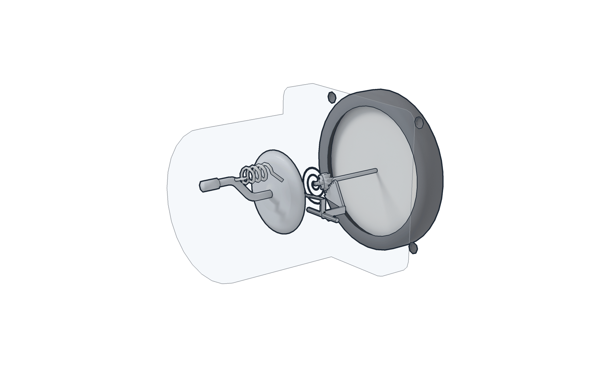

```
npm run part -- render --part @vertical_speed_indicator --ghost PANEL.VSI.case --azimuth 50 --elevation 18 --margin 1.1
```

## Inside the attitude indicator: rotor with an upright axis, two gimbals, horizon bar, air nozzle

<div dir="rtl">داخل مؤشر الوضع: دوّار بمحور رأسي وحلقتان وقضيب الأفق وفوهة الهواء</div>

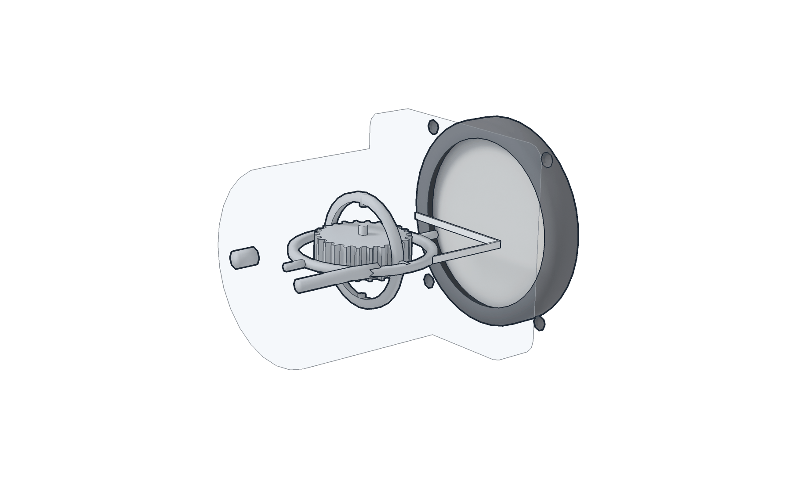

```
npm run part -- render --part @attitude_indicator --ghost PANEL.AI.case --azimuth 50 --elevation 18 --margin 1.1
```

## Inside the directional indicator: rotor with a level axis, two gimbals, gears to the heading card, setting knob

<div dir="rtl">داخل المؤشر الاتجاهي: دوّار بمحور أفقي وحلقتان وتروس قرص الاتجاه ومقبض الضبط</div>

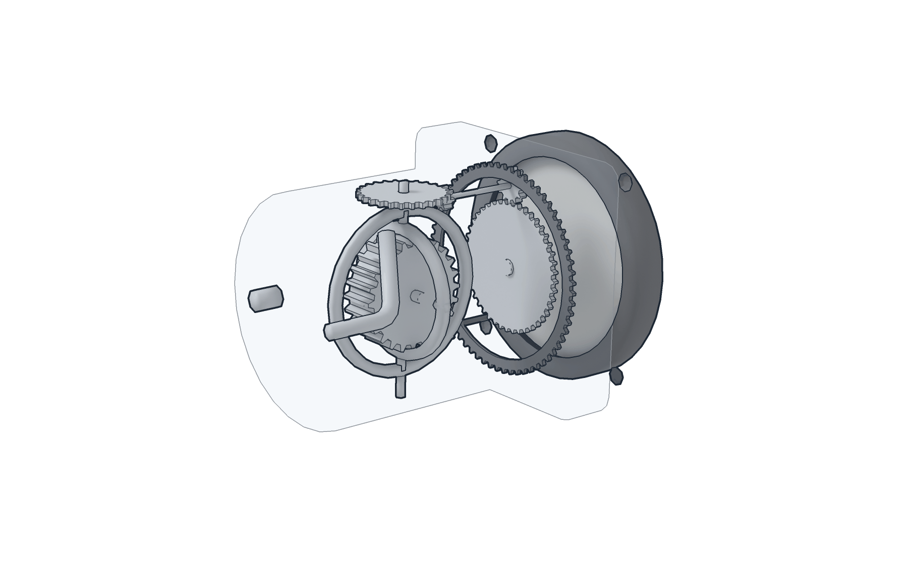

```
npm run part -- render --part @directional_gyro --ghost PANEL.DG.case --azimuth 50 --elevation 18 --margin 1.1
```

## Inside the turn coordinator: electric rotor, gimbal tilted 30 degrees, centring spring, damper

<div dir="rtl">داخل منسق الانعطاف: دوّار كهربائي وحلقة مائلة 30 درجة ونابض التوسيط والمخمّد</div>

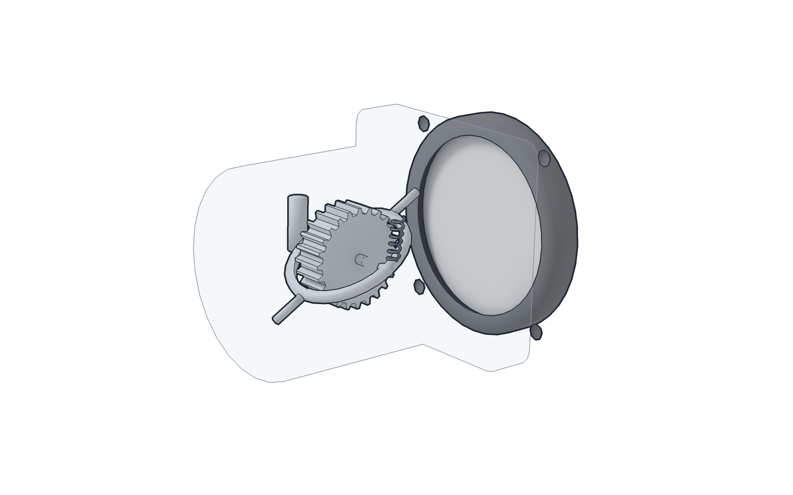

```
npm run part -- render --part @turn_coordinator --ghost PANEL.TC.case --azimuth 50 --elevation 18 --margin 1.1
```

## Inside the tachometer: drive cable, rotating magnet, drag cup and hairspring

<div dir="rtl">داخل عدّاد الدورات: كابل التدوير والمغناطيس الدوّار وكأس السحب والنابض الشعري</div>

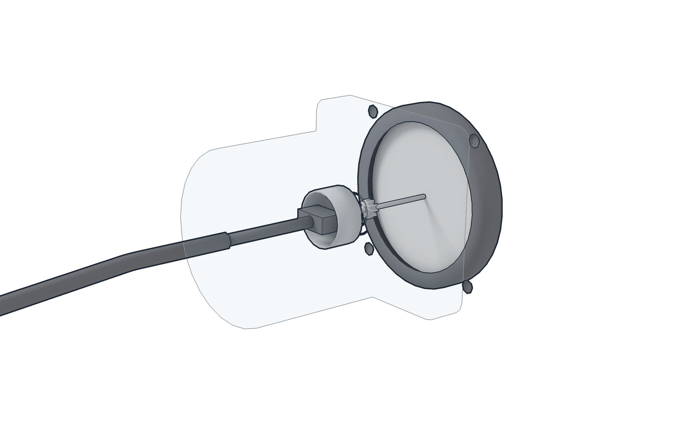

```
npm run part -- render --part @tachometer --ghost PANEL.TACH.case --focus PANEL.TACH.case PANEL.TACH.bezel --azimuth 50 --elevation 18 --margin 1.1
```

## Rivet rows and tank cover screws on the left wing (detail level 2)

<div dir="rtl">صفوف البرشام وبراغي غطاء الخزان على الجناح الأيسر (مستوى التفصيل 2)</div>

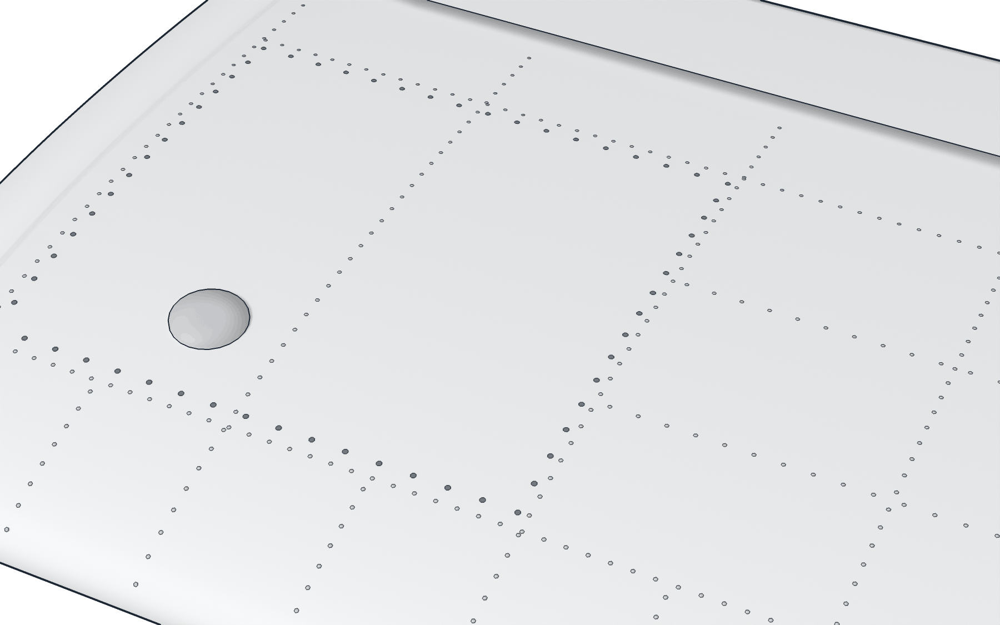

```
npm run part -- render --part WING_L.wing WING_L.flap WING_L.fuel_cap 'WING_L.rivets_*' WING_L.fuel_tank_cover_screws --focus WING_L.fuel_tank_cover_screws WING_L.rivets_rib_ws072_upper --azimuth 25 --elevation 48 --margin 0.5
```

## Standard hardware, each at its real size

<div dir="rtl">العتاد القياسي، كل قطعة بحجمها الحقيقي</div>

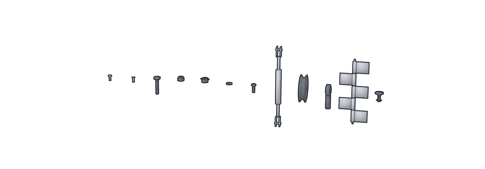

```
npm run part -- render --part 'HARDWARE.*' --azimuth 12 --elevation 18 --size 2000x700 --margin 0.6
```
