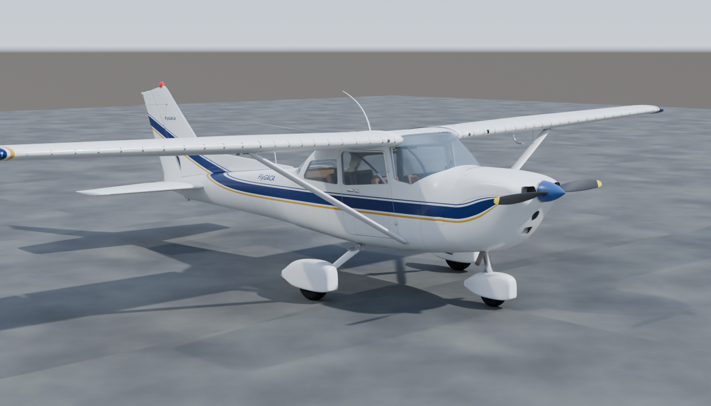
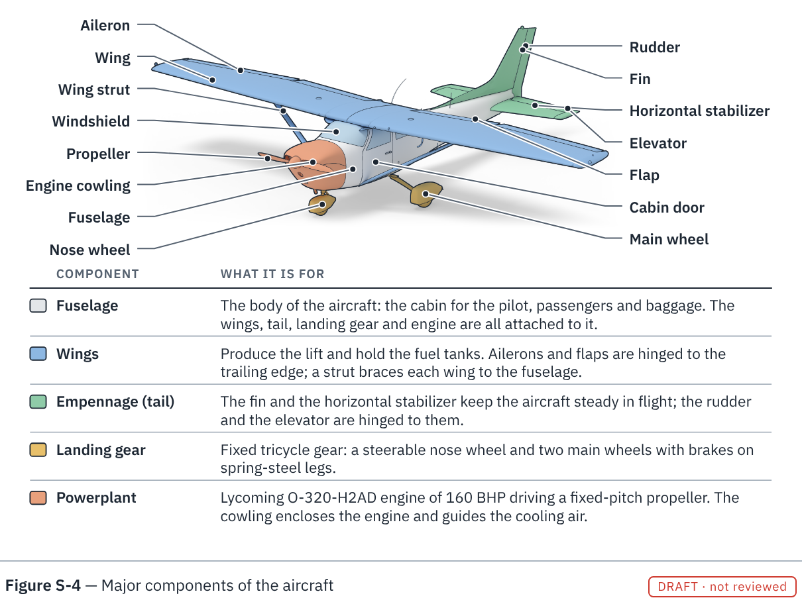

# FlyGACA — Cessna 172N Digital Twin

Canonical repository for the FlyGACA Cessna 172N educational 3D project (replaces `n172`).
Reference aircraft: **Cessna 172N, 1979 model**, factory-standard educational baseline;
the configuration of a specific serial number is not verified.

**Latest: [Phase 8 — realistic digital twin (Blender-built airframe, cockpit, engine)](08_realistic_digital_twin/)**
and **[Phase 9 — book figures](09_book_figures/)**. The outline of the Phase 8 airframe follows the
manufacturer's three-view drawing ([how](08_realistic_digital_twin/docs/05_shape_reference.md)), and the
model goes under the skin: structure, control runs, systems, the insides of the engine and of the
instruments, cabin air and lights, and fasteners, as 1,107 separate named parts,
any of which can be drawn or exported on its own ([parts index](08_realistic_digital_twin/docs/06_parts_index.md),
[atlas](09_book_figures/atlas/README.md)).

```bash
python3 -m http.server 8000
# then open http://localhost:8000/08_realistic_digital_twin/   (Phase 7: /07_kinematic_twin/)
```





## Phases

| # | Folder | Contents |
|---|---|---|
| 01 | [`01_initial/`](01_initial/) | First editable airframe GLB and its Python/trimesh generator |
| 02 | [`02_classic_analog_v2/`](02_classic_analog_v2/) | Classic analog model, browser viewer, reference photos |
| 02b | [`02b_refined_airframe/`](02b_refined_airframe/) | Refined Phase 2 GLB, Blender enhancement script, viewer, photos |
| 03 | [`03_education/`](03_education/) | Exploded engine, instrument training lab, curriculum |
| 04 | [`04_digital_twin/`](04_digital_twin/) | C172N systems GLB, approximate airframe, learning lab |
| 04b | [`04b_poh_reference/`](04b_poh_reference/) | 1979 POH reference data and revised lab |
| 05 | [`05_systems_lab/`](05_systems_lab/) | Interactive systems lab, lessons, build script |
| 06 | [`06_interactive_twin/`](06_interactive_twin/) | 224-part GLB, Three.js viewer, manifest |
| 07 | [`07_kinematic_twin/`](07_kinematic_twin/) | Rebuilt model with pivots and Lycoming-correct engine, crank-driven animation, documented systems simulation, 10 guided POH scenarios, offline viewer, tests |
| **08** | [**`08_realistic_digital_twin/`**](08_realistic_digital_twin/) | Blender-scripted realistic model (editable `.blend`, three Draco GLB quality levels, generated PBR textures), full cockpit and O-320 engine assembly, PBR viewer with HDR sky, shadows and AO, bilingual part catalogue, Phase 7 simulation and scenarios, Playwright and CI rebuild checks |
| 09 | [`09_book_figures/`](09_book_figures/) | Book figures: [the figure plan](09_book_figures/PLAN.md), a browser-based build to print-ready PDF/SVG in English and Arabic, and four sample figures (instrument from data, system schematic, two labelled illustrations drawn from the Phase 8 model) |

Folders 01–06 are the original release packages, imported unchanged; see
[RELEASES.md](RELEASES.md). Their integrity is checked against
[`SHA256SUMS.txt`](SHA256SUMS.txt) (the upload package's own README is kept at
[`docs/archive/UPLOAD_PACKAGE_README.md`](docs/archive/UPLOAD_PACKAGE_README.md)).

## Development

| Command | What it does |
|---|---|
| `npm run build:model` | Rebuild the Phase 7 GLB (Python 3 + numpy) |
| `npm run build:model8` | Rebuild the Phase 8 `.blend` and GLBs (downloads Blender 4.5 LTS on first use) |
| `npm run textures8` | Regenerate the Phase 8 textures and sky HDR (numpy + Pillow) |
| `npm run validate:glb8` / `npm run test:py8` | Phase 8 GLB structure check / pure-Python tests |
| `npm run validate:geometry8` | Check mesh health, published dimensions of the built model, attachments, and that nothing inside shows through the skin |
| `npm run quality` | Validate bilingual metadata, provenance, generated indexes, the parts list and asset budgets |
| `npm run parts:index` | Write the parts index (`08_realistic_digital_twin/docs/06_parts_index.md`) from the built model's parts list |
| `npm run part:list` / `npm run part -- render ...` / `npm run part -- export ...` | List every part of the Phase 8 model; draw any part, assembly or system on its own or in the phantom aircraft; export it as a GLB |
| `python3 09_book_figures/atlas.py` | Redraw the atlas: one picture of every assembly under the skin |
| `npm run threeview8 -- --out DIR` | Scaled outline drawings of the model, to lay over the handbook three-view |
| `npm run measurements:validate` / `npm run measurements:report` | Validate the aircraft survey and compare it with model references |
| `npm run test:e2e8` | Phase 8 browser test (three quality levels, phone width, Arabic) |
| `npm run render8` / `npm run gallery8` | Cycles reference renders and print-size gallery views of the Phase 8 model |
| `npm run figures` | Build the book figures (PDF, SVG, review PNG; English and Arabic) into `09_book_figures/out/` |
| `npm run figures:render` | Re-render the 3D-derived book illustrations and their label anchors in Blender |
| `npm run figures:check` / `npm run test:figures:py` | Build every figure into a temporary folder (fails if text runs off a figure) / test the ink-line rules of the illustrations |
| `npm run verify:model` | Rebuild in a temp dir and compare with the committed GLB |
| `npm run verify:checksums` | Verify the archived phase packages |
| `npm test` | Unit tests: kinematics, POH-referenced simulation behaviour, scenarios, book-figure manifest and provenance |
| `npm run test:e2e` | Browser test with Playwright (`npm ci && npx playwright install chromium` first) |

The Phase 7 and Phase 8 viewers share their simulation, scenarios, and SVG gauges from
[`shared/js/`](shared/js/); the phase-local modules are compatibility entry points.

GitHub Actions runs all of the above on every pull request and push to `main`, and a second job
rebuilds the Phase 8 model with the pinned Blender and compares it with the committed files.
For a dedicated runner, follow [the self-hosted runner guide](docs/SELF_HOSTED_RUNNER.md).

## Safety

All geometry, instruments, engine behaviour and fault scenarios are educational
approximations. They are not validated against a specific aircraft serial number
and are not approved for flight, maintenance or training credit. Refer to the
aircraft-specific POH/AFM and Cessna/Lycoming manuals.
